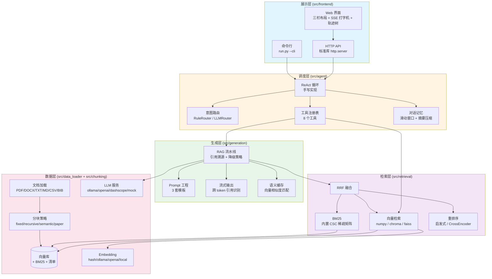
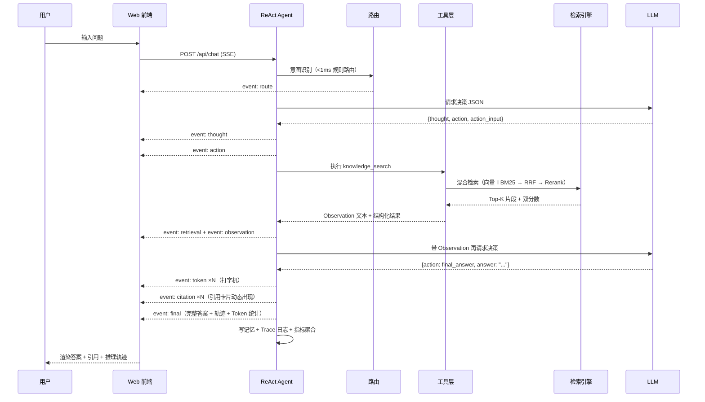

# 智能科研助理 —— 基于 RAG + Agent 的论文知识库问答系统

> 面向科研文献的检索增强问答系统。上传论文 → 混合检索 → Agent 自主决策 → 带引用溯源的回答，
> 并且**把 Agent 的每一步推理都摊开给用户看**。

<p align="center">
  <b>在线大模型</b> · <b>联网搜索</b> · <b>引用可追溯</b> · <b>全链路可观测</b>
</p>

---

## 目录

- [核心特性](#核心特性)
- [快速开始](#快速开始)
- [API 密钥安全配置](#api-密钥安全配置)
- [系统架构](#系统架构)
- [目录结构](#目录结构)
- [配置说明](#配置说明)
- [命令行用法](#命令行用法)
- [模型与搜索引擎选型](#模型与搜索引擎选型)
- [Docker 部署](#docker-部署)
- [API 文档](#api-文档)
- [测试](#测试)
- [课程交付物](#课程交付物)
- [常见问题](#常见问题)
- [设计取舍](#设计取舍)

---

## 核心特性

### 检索层：为什么比朴素 RAG 准

| 能力 | 做法 | 解决的问题 |
|---|---|---|
| **混合检索** | 向量召回（语义泛化）‖ BM25 召回（精确词面） | 纯向量对专有名词/缩写（`BatchNorm`、`mAP@0.5`）匹配不稳 |
| **RRF 融合** | 倒数排名融合，只用排名不用分数 | 向量相似度（0~1）与 BM25 分数（无上界）**量纲不同**，加权求和需要归一化且对分布敏感 |
| **重排序** | Top-20 交给交叉编码器精排 | 双塔召回精度有限，交叉编码精度高但太慢，只能用于小候选集 |
| **双分数体系** | `score`（相对展示分）+ `confidence`（绝对相关度） | 归一化后 Top-1 恒为 1.0，**无法判断"到底有没有检索到"**，导致降级永不触发 |
| **论文专用分块** | 参考文献剔除、公式行保护、标题吸附、跨页合并 | 通用分块器会把文献条目、半个公式切进检索块 |

### Agent 层：自主决策 + 全程透明

- **手写 ReAct 循环**（不依赖 LangChain）：Thought → Action → Observation，每一轮都把
  完整轨迹重新喂给模型，让无状态 LLM 表现出有状态行为。
- **8 个工具**：知识库检索、论文元信息、论文对比、关键词提取、结构化摘要、当前时间、
  计算器（AST 白名单求值，**拒绝任意代码执行**）、联网搜索（可选）。
- **工具选择路由**：一次廉价意图识别把候选工具从 8 个缩到 1~3 个，
  并对"3.14 乘 2.56"这类问题直接跳过整个循环 —— 省 Token、少选错。
- **并行工具调用**：一轮内多个独立工具并发执行（实测 3×0.5s → 0.6s）。
- **错误恢复**：超时重试 → 换工具 → 记录错误观察让模型自行调整。
- **死循环检测**：滑动窗口内 `(action, args)` 指纹重复即强制终止，
  并**用已有信息收尾**，而不是甩给用户一句"推理超限"。
- **记忆管理**：会话隔离 + 滑动窗口 Token 预算 + 长对话摘要压缩。

### 回答质量：可信度优先于流畅度

- **强制引用溯源**：每个事实标注 `【文档名 p.页码】`，前端渲染成可点击角标。
- **三档降级策略**：
  - 检索无结果 → `no_result`（明确告知知识库未命中）
  - 相关性过低 → `low_relevance`（提示用户并展示实际检索到的内容）
  - 模型调用失败 → `llm_error`（返回友好错误 + 可操作建议，检索结果仍可用）
- **语义缓存**：向量相似度匹配（阈值 0.93），换个说法问同一件事也能命中。

### 可观测性：AI 为什么这么答

完整记录并可视化：每次推理的 Token 消耗、检索命中率与延迟分解、
工具调用成功率、`Thought → Action → Observation` 全链路轨迹。

---

## 快速开始

### 环境要求

- **Python 3.10+**（使用了 PEP 604 语法）
- **NumPy**（唯一的必需第三方依赖）
- **可访问 `api.deepseek.com` 的网络**（在线大模型）
- **可访问搜索引擎的网络**（联网搜索；必应/百度任一可达即可）

PDF 解析、向量检索、BM25、Agent、Web 服务全部使用标准库实现。

### 三步启动

```bash
# 1) 安装唯一必需依赖
pip install numpy

# 2) 配置 API 密钥（只需一次，见下一节）
python -m src.utils.secrets set llm_api_key

# 3) 环境自检 + 生成样例论文 + 建立索引 + 启动
python scripts/bootstrap.py --index
python run.py
```

`python run.py` 启动后会**自动打开浏览器**并跳到 <http://127.0.0.1:8501>
（Docker / 无桌面环境会自动跳过；加 `--no-open` 可强制不打开）。

> 大模型默认使用 **DeepSeek（`deepseek-chat`）**，联网搜索默认使用
> **必应（无需任何额外密钥）**。两项都开箱即用，无需改配置。

### 最快验证方式（无界面）

```bash
# 查看各组件健康状态（含密钥掩码与联网引擎状态）
python run.py --health

# 真实探测各搜索引擎在当前网络下的可达性
python -c "import sys;sys.path.insert(0,'.');from src.utils.config import load_config;
from src.agent.tools import WebSearchTool;from pprint import pprint;pprint(WebSearchTool(load_config()).probe())"

# 查看 8 个工具及其参数
python run.py --list-tools

# 批量导入论文后退出
python run.py --index ./data/samples

# 命令行交互问答
python run.py --cli
```

命令行交互模式的真实输出：

```
你 > Transformer 训练用了哪些数据集？

助理 > 根据知识库中的论文，Transformer 在 WMT 2014 的两个翻译数据集上训练：
       - WMT 2014 英德数据集，约 450 万句对【Attention Is All You Need p.2】
       - WMT 2014 英法数据集，约 3600 万句【Attention Is All You Need p.2】
       句子使用 byte-pair encoding（BPE）进行编码【Attention Is All You Need p.2】。

引用来源
  [1] Attention Is All You Need p.2  (相关度 0.67)
  [2] Attention Is All You Need p.1  (相关度 0.15)

推理轨迹
  [思考] 该问题涉及知识库中的论文内容，需要先检索相关资料再回答。
  [行动] knowledge_search({"query": "Transformer training datasets WMT 2014 ...", "top_k": 5})
  [观察] 检索「...」共命中 5 个片段（档位 full）...

  耗时 1.7s · 轮次 2 · 工具 1 次 · Token 2755 · 终止原因 final_answer
```

---

## API 密钥安全配置

密钥**绝不写入 `config.yaml`，也绝不进入版本库**。系统提供三种配置方式，
优先级为 **环境变量 > 密封凭据库 > config.yaml（永远留空）**。

### 方式一：密封凭据库（推荐，本地开发）

明文不落盘 —— 文件内容经过 XOR 流加密后再 Base64 编码，直接打开只看到密文，
`git grep` 也搜不到明文。

```bash
# 交互式输入（不回显，不留在命令行历史里）
python -m src.utils.secrets set llm_api_key

# 查看状态 —— 只显示掩码与指纹，不显示明文
python -m src.utils.secrets status

# 清除
python -m src.utils.secrets clear llm_api_key
```

`status` 输出示例：

```
  密封文件: .../data/secrets/credentials.sealed.json
  文件存在: 是

  ✔ llm_api_key              sk-7d2****901d       来源: 密封文件
     指纹 cf912cb7 · 长度 35 · 环境变量 APP_LLM__API_KEY
  – embedding_api_key        （未配置）            来源: 未配置
```

密封文件长这样（密文，不可读）：

```json
{
  "version": 1,
  "secrets": { "llm_api_key": "JtuYdVE6EPjB7FDF5kf-xSQ4RX_ucBsaHniRP0Wbsh7cNvA=" }
}
```

### 方式二：环境变量（推荐，CI / 生产 / Docker）

```bash
# Linux / macOS
export APP_LLM__API_KEY="sk-xxxxxxxxxxxxxxxx"

# Windows PowerShell
$env:APP_LLM__API_KEY = "sk-xxxxxxxxxxxxxxxx"
```

环境变量优先级最高，会覆盖密封库中的值。

### 方式三：`.env` 文件（本地便捷）

若你习惯用 `.env`，可在启动前手动加载（`.env` 已在 `.gitignore` 中）：

```bash
# Linux / macOS
set -a; source .env; set +a
```

```powershell
# Windows PowerShell
Get-Content .env | ForEach-Object {
  if ($_ -match '^\s*([^#][^=]*)=(.*)$') { Set-Item "env:$($matches[1].Trim())" $matches[2].Trim() }
}
```

### 四层防护机制

| 防护 | 机制 | 效果 |
|---|---|---|
| **不明文落盘** | XOR 流密封 + Base64 | 文件被打开/被误提交也读不出密钥 |
| **不入版本库** | `.gitignore` 含 `data/secrets/`、`*.sealed.json` | `git add .` 不会带上密钥 |
| **不回显** | 日志过滤器 + 接口掩码 | 任何日志与 JSON 响应中只出现 `sk-7d2****901d` |
| **不进镜像** | `.dockerignore` 排除凭据目录 | 镜像内不含密钥，运行时用环境变量注入 |

**日志自动脱敏**：系统在日志 handler 上装了过滤器，
凡形如 `sk-...`、`Bearer xxx`、`api_key=xxx` 的内容都会被替换成掩码 ——
即使异常栈里夹带了请求头，也不会把密钥写进 `logs/`。

**安全边界（请知悉）**：密封机制用于防**明文泄露**（肩窥、误提交、日志抓取），
**不是**用于防御拥有本机读取权限的攻击者 —— 解封逻辑就在代码里。
对本项目（个人科研助手、单机部署）这是恰当的权衡；
若需真正的密钥保护，应改用操作系统凭据管理器或 KMS。

---

## 系统架构



一次问答的完整时序：



---

## 目录结构

```
project/
├── run.py                        # 一键启动入口
├── config.yaml                   # 全局配置（逐项注释）
├── requirements.txt              # 依赖清单（全部可选，见文件内说明）
├── README.md
├── scripts/
│   └── bootstrap.py              # 环境自检 + 数据准备
├── src/
│   ├── llm.py                    # LLM 接入层（4 种 provider + MockLLM）
│   ├── embeddings.py             # 向量化层（4 种 provider + 持久化缓存）
│   ├── utils/                    # 基础设施
│   │   ├── config.py             #   配置系统（YAML + 环境变量 + 点号路径）
│   │   ├── types.py              #   全系统数据契约（16 个 dataclass）
│   │   ├── logger.py             #   日志 / Trace / 指标聚合
│   │   ├── storage.py            #   原子 JSON / SQLite 池 / 文件锁
│   │   └── text.py               #   中英文分词 / 切句 / 关键词
│   ├── data_loader/              # ── 模块一：文档加载
│   │   ├── pdf_loader.py         #   内置纯标准库 PDF 解析器（含 ToUnicode CMap）
│   │   ├── docx_loader.py        #   内置 OOXML 解析器（含 WPS 数字样式 ID）
│   │   ├── text_loader.py        #   TXT/MD/CSV/BIB/JSON + 编码探测
│   │   └── loader.py             #   统一分派 + 批量导入（进度/重试）
│   ├── chunking/                 # ── 模块一：分块
│   │   └── strategies.py         #   fixed / recursive / semantic / paper
│   ├── retrieval/                # ── 模块一：检索
│   │   ├── vector_store.py       #   numpy / chroma / faiss
│   │   ├── bm25_retriever.py     #   BM25（scipy 可选，内置 CSC 回退）
│   │   ├── hybrid_retriever.py   #   RRF 融合 + 双分数体系
│   │   ├── reranker.py           #   启发式（6 特征）/ Ollama / CrossEncoder
│   │   └── engine.py             #   检索层门面 + 评估指标
│   ├── generation/               # ── 模块二：RAG 生成层
│   │   ├── prompt_template.py    #   3 套模板 + 引用解析
│   │   ├── rag_pipeline.py       #   流水线 + 降级策略
│   │   ├── streaming.py          #   事件流 + 跨 token 引用识别
│   │   └── cache.py              #   语义缓存
│   ├── agent/                    # ── 模块三：Agent 决策层
│   │   ├── react_loop.py         #   手写 ReAct 循环
│   │   ├── base_tool.py          #   工具框架（schema + 参数校验）
│   │   ├── tools.py              #   8 个工具
│   │   ├── router.py             #   规则 / LLM 意图路由
│   │   ├── memory.py             #   会话隔离 + 滑动窗口 + 摘要压缩
│   │   └── prompts.py            #   System Prompt 工程
│   ├── frontend/                 # ── 模块四：集成与界面
│   │   ├── container.py          #   全链路依赖装配
│   │   ├── server.py             #   HTTP + SSE 服务
│   │   ├── app.py                #   CLI / 参数解析
│   │   └── static/               #   Web 界面（零构建）
│   │       ├── index.html
│   │       ├── css/style.css     #     双主题 + 三栏响应式
│   │       └── js/
│   │           ├── app.js        #     SSE 解析 / 轨迹树 / 指标面板
│   │           └── markdown.js   #     自研 Markdown（转义优先，防 XSS）
│   └── evaluation/               # ── 模块五：评测
│       ├── metrics.py            #   Hit@K / MRR / NDCG / 引用准确性 …
│       ├── eval_set.py           #   60+ 问答对（4 类问题）
│       ├── benchmark.py          #   检索三档 / Agent / 端到端评测
│       ├── badcase.py            #   Bad Case 分类与根因分析
│       └── report.py             #   报告生成（MD / JSON / XLSX）
├── tests/                        # 测试套件（unittest，零依赖）
│   ├── common.py                 #   公共夹具（临时工作区、样例语料）
│   ├── fixtures/make_sample_pdf.py  # 样例论文 PDF 生成器
│   └── test_*.py                 #   8 个测试模块
├── docs/
│   ├── 技术设计文档.md
│   └── 用户使用手册.md
├── reports/                      # 评测产出
│   ├── 评测集.json
│   ├── 性能评测数据.{json,xlsx}
│   ├── 系统评测报告.md
│   └── Bad_Case分析报告.md
├── docker/
│   ├── Dockerfile
│   └── docker-compose.yml
└── data/                         # 运行时数据（已 gitignore）
    ├── uploads/                  #   上传的论文原文
    ├── vector_store/             #   向量索引
    ├── index/                    #   分块清单 + 文档清单
    ├── cache/                    #   语义缓存 + 向量缓存
    └── memory/                   #   对话记忆数据库
```

---

## 配置说明

所有配置集中在 `config.yaml`，每个字段都有中文注释。配置优先级：

```
内置默认值  <  config.yaml  <  环境变量 APP_*  <  代码显式传参
```

环境变量用双下划线表示层级：

```bash
# Linux / macOS
export APP_LLM__PROVIDER=ollama
export APP_RETRIEVAL__TOP_K=10
```

```powershell
# Windows PowerShell
$env:APP_LLM__PROVIDER = "ollama"
$env:APP_RETRIEVAL__TOP_K = "10"
```

### 常用调参速查

| 想改善什么 | 改哪个配置 | 建议 |
|---|---|---|
| 检索结果不相关 | `retrieval.top_k` ↑、`retrieval.candidate_k` ↑ | 先加大候选池，再看重排序效果 |
| 长文档答案被截断 | `chunking.chunk_size` ↑ | 但过大会稀释语义，建议 256~1024 间调 |
| 答案缺少上下文 | `chunking.chunk_overlap` ↑ | 建议 chunk_size 的 10~20% |
| 专有名词检索不到 | 确认 `retrieval.enable_bm25: true` | BM25 负责精确词面匹配 |
| 无关问题也硬答 | `retrieval.low_relevance_threshold` ↑ | 提高降级触发门槛（默认 0.25） |
| Agent 推理太慢 | `agent.max_iterations` ↓、`agent.enable_router: true` | 路由能省掉无谓轮次 |
| Token 消耗太高 | `generation.max_context_chars` ↓ | 默认 6000 字符 |
| 回答太长 | `llm.max_tokens` ↓ | 默认 1024 |

---

## 命令行用法

```bash
python run.py [选项]

  --host HOST           监听地址（默认 127.0.0.1）
  --port PORT           监听端口（默认 8501，被占用时自动顺延）
  --config PATH         指定配置文件
  --open                启动后自动打开浏览器（默认行为，保留以兼容旧命令）
  --no-open             启动后不打开浏览器（Docker / 无桌面环境自动跳过）
  --cli                 命令行交互模式
  --index PATH          导入文件或目录后退出
  --strategy NAME       分块策略：fixed / recursive / semantic / paper
  --list-tools          列出全部工具后退出
  --health              打印健康检查结果后退出
  --json                配合 --health 输出 JSON
  --log-level LEVEL     DEBUG / INFO / WARNING / ERROR
```

启动横幅会把关键配置与健康状态一次打出来：

```
══════════════════════════════════════════════════════════════════════
  智能科研助理 —— 基于 RAG + Agent 的论文知识库问答系统  v1.0.0
══════════════════════════════════════════════════════════════════════
  LLM 服务    : ollama/qwen2.5:7b ✔
  Embedding   : ollama/bge-large-zh (dim=1024)
  向量库      : numpy · 128 向量
  知识库      : 3 篇文档 / 42 个片段
  对话记忆    : sqlite · 2 个会话
  语义缓存    : sqlite
══════════════════════════════════════════════════════════════════════
```

---

## 模型与搜索引擎选型

### 当前默认配置（开箱可用）

```yaml
llm:
  provider: openai                        # OpenAI 兼容协议
  model: deepseek-chat
  base_url: https://api.deepseek.com
  api_key: ""                             # ← 永远留空，走密封库/环境变量

web_search:
  enabled: true
  provider: auto                          # bing → so360 → sogou → baidu 自动降级
```

### 联网搜索：国内网络环境实测可用

**网页搜索**（无需任何 API Key，直接复用本机网络出口）：

| 引擎 | 说明 | 本机实测 |
|---|---|---|
| **bing** | 必应中国 `cn.bing.com` | ✔ **首选**。3/3 次成功，~260ms，返回高质量中文结果（知乎/CSDN/DataWhale 等） |
| **so360** | 360 搜索 `www.so.com` | ~ 国内站点。无 Cookie 裸请求下约半数概率返回反爬验证页（6KB），列为次选 |
| **sogou** | 搜狗 | ✘ 实测返回验证页，仅后备 |
| **baidu** | 百度 | ✘ 实测返回"安全验证"页，仅后备 |
| **duckduckgo** | 国外源 | ✘ 国内超时，最后兜底 |

**学术搜索**（`scope="academic"`，返回结构化论文元数据）：

| 引擎 | 返回字段 | 用途 |
|---|---|---|
| **arxiv** | 标题 / 作者 / 摘要 / 发布日期 / 链接 | 找最新预印本工作 |
| **crossref** | 标题 / 作者 / **DOI** / 期刊 / 年份 | 核对文献、拿到权威 DOI |

> **为什么首选必应而不是国产引擎？**
> 排序依据是**实测稳定性**而非"是否国内站点"。必应中国可直连且持续可用；
> 360/搜狗/百度在无 Cookie 的裸请求下都会间歇性返回人机验证页。
> 系统会**自动降级** —— 首选失败就换下一个，无需人工干预。
> 被识别的验证页会给出明确原因（而不是伪装成"无结果"）。

`provider: auto`（默认）自动选择，随时可用以下命令查看实时可达性：

```bash
# 网页引擎
python -c "import sys;sys.path.insert(0,'.');from src.utils.config import load_config;
from src.agent.tools import WebSearchTool;from pprint import pprint;pprint(WebSearchTool(load_config()).probe('web'))"

# 学术源
python -c "import sys;sys.path.insert(0,'.');from src.utils.config import load_config;
from src.agent.tools import WebSearchTool;from pprint import pprint;pprint(WebSearchTool(load_config()).probe('academic'))"
```

或走 HTTP：`GET /api/health?probe_web=1`（网页）、`?probe_web=academic`（学术）。

### 切换大模型

**改为其他 OpenAI 兼容服务**（OpenAI / vLLM / LM Studio / 硅基流动 / 月之暗面…）：

```bash
python -m src.utils.secrets set llm_api_key     # 换成新服务的密钥
```

```yaml
llm:
  provider: openai
  model: gpt-4o                    # 或 deepseek-flash / glm-4 / qwen-plus …
  base_url: https://api.openai.com # 换成对应服务的地址
```

**改为本地 Ollama（数据完全不出本机）**：

```bash
ollama pull qwen2.5:7b && ollama pull bge-large-zh
```

```yaml
llm:       { provider: ollama, model: qwen2.5:7b, base_url: "http://127.0.0.1:11434" }
embedding: { provider: ollama, model: bge-large-zh, dimension: 1024 }
```

**改为阿里云 DashScope**：

```yaml
llm: { provider: dashscope, model: qwen-plus, base_url: "", api_key: "" }
```

### 关于向量化（Embedding）—— 一个必须说明的限制

**DeepSeek 不提供 embedding 接口**（`/v1/embeddings` 返回 404），
因此默认使用内置的 `hash` 哈希 n-gram 向量化器。

这意味着**当前的语义检索能力是"词面近似"级别**，不是真正的神经网络语义向量：

- ✔ 英文提问 + 英文论文：效果良好（实测三档检索 Hit@5 = 0.80~0.83）
- ✔ 含专有名词/数字的提问：BM25 路能精确匹配
- ⚠️ 中文提问查英文论文：靠英文术语（WMT 2014、BLEU、ImageNet）搭桥，召回会偏低
- ⚠️ 纯同义改写（"过拟合怎么办" ↔ "正则化策略"）：无法识别

**如果要获得真正的语义检索，选任一即可**（无需改动业务代码）：

```yaml
# 选项 1：本地 Ollama（免费、离线、推荐）
embedding: { provider: ollama, model: bge-large-zh, dimension: 1024 }

# 选项 2：硅基流动等 OpenAI 兼容 embedding 服务（需其自家密钥，与 DeepSeek 密钥不通用）
embedding:
  provider: openai
  model: BAAI/bge-large-zh-v1.5
  base_url: https://api.siliconflow.cn
  api_key: ""        # 用 python -m src.utils.secrets set embedding_api_key 配置

# 选项 3：本地 sentence-transformers
embedding: { provider: local, model: BAAI/bge-large-zh-v1.5 }
```

> **⚠️ 更换 Embedding 模型会改变向量维度，必须重建索引**：
> 删除 `data/vector_store/` 与 `data/index/` 后重新导入论文。

### 离线/测试模式

CI 与单元测试使用确定性后端，不发起任何网络请求：

```yaml
llm:       { provider: mock }   # 确定性启发式结果
embedding: { provider: hash }   # 哈希向量
```

---

## Docker 部署

### 在线模式（默认，使用 DeepSeek）

密钥通过环境变量注入，**不打进镜像**（`.dockerignore` 已排除 `data/secrets/`）：

```bash
# Linux / macOS
export APP_LLM__API_KEY="sk-xxxxxxxxxxxxxxxx"
docker compose -f docker/docker-compose.yml up -d --build
# → http://127.0.0.1:8501
```

```powershell
# Windows PowerShell
$env:APP_LLM__API_KEY = "sk-xxxxxxxxxxxxxxxx"
docker compose -f docker/docker-compose.yml up -d --build
```

### 本地大模型模式（数据不出容器网络）

```bash
docker compose -f docker/docker-compose.yml --profile ollama up -d
# 会自动拉取 qwen2.5:7b 与 bge-large-zh，并把 app 指向 ollama 服务
```

### 离线演示模式（无网络也能跑通全链路）

```bash
$env:LLM_PROVIDER = "mock"
docker compose -f docker/docker-compose.yml up -d --build
```

数据通过卷持久化：`data/`（索引与向量）、`logs/`、`reports/`。

---

## API 文档

所有响应为 JSON；错误统一 `{"ok": false, "error": "..."}` 并带合适状态码。

| 方法 | 路径 | 说明 |
|---|---|---|
| GET | `/api/health` | 健康检查（各组件状态） |
| GET | `/api/config` | 当前生效配置 |
| GET | `/api/stats` | 运行统计 |
| GET | `/api/metrics` | 指标快照（命中率/延迟/工具成功率） |
| GET | `/api/tools` | 工具清单与 JSON Schema |
| GET | `/api/traces?n=20` | 最近请求轨迹 |
| GET | `/api/documents` | 知识库文档列表 |
| POST | `/api/documents/upload` | 上传文档（**SSE 进度流**） |
| POST | `/api/documents` | 按服务器路径导入 |
| POST | `/api/documents/reindex` | 重建索引 |
| DELETE | `/api/documents/{doc_id}` | 删除文档 |
| GET/POST | `/api/sessions` | 会话列表 / 新建 |
| GET/PUT/DELETE | `/api/sessions/{id}` | 会话详情 / 重命名 / 删除 |
| POST | `/api/feedback` | 记录用户反馈（up/down） |
| POST | `/api/chat` | **对话（SSE 流式或一次性 JSON）** |
| POST | `/api/search` | 纯检索（三档模式，用于调试） |
| POST | `/api/retrieve` | RAG 问答（绕过 Agent） |

### SSE 事件协议

```
event: start        data: {"session_id":"sess_x","question":"..."}
event: route        data: {"tools":["knowledge_search"],"reason":"..."}
event: thought      data: {"round":1,"content":"需要先检索知识库"}
event: action       data: {"round":1,"tool":"knowledge_search","args":{...}}
event: retrieval    data: {"num":5,"results":[{"source":"...","page":4,"confidence":0.93}]}
event: observation  data: {"round":1,"tool":"...","status":"success","latency_ms":35.2}
event: token        data: {"text":"根据"}
event: citation     data: {"index":1,"source":"...","page":4}
event: final        data: {"answer":"...","citations":[...],"trajectory":[...],"usage":{...}}
event: done         data: {"trace_id":"atrace_x"}
event: error        data: {"message":"...","recoverable":true}
```

> `error` 事件带 `recoverable: true` 时表示"某个工具调用失败但 Agent 已自行恢复"，
> 前端不应中断整个回答。只有致命错误才终止流。

### curl 示例

```bash
# 上传论文
curl -X POST http://127.0.0.1:8501/api/documents/upload \
  -H "Content-Type: application/json" \
  -d "{\"filename\":\"paper.pdf\",\"content_base64\":\"$(base64 -w0 paper.pdf)\"}"

# 提问（流式）
curl -N -X POST http://127.0.0.1:8501/api/chat \
  -H "Content-Type: application/json" \
  -d '{"question":"这篇论文用了什么数据集？","stream":true}'

# 提问（一次性）
curl -X POST http://127.0.0.1:8501/api/chat \
  -H "Content-Type: application/json" \
  -d '{"question":"这篇论文用了什么数据集？","stream":false}'
```

---

## 测试

```bash
# 运行全部测试
python -m unittest discover -s tests -v

# 按模块运行
python -m unittest tests.test_utils -v           # 基础设施
python -m unittest tests.test_data_loader -v     # 模块一：文档加载
python -m unittest tests.test_retrieval -v       # 模块一：分块与检索
python -m unittest tests.test_generation -v      # 模块二：RAG 生成
python -m unittest tests.test_agent -v           # 模块三：Agent
python -m unittest tests.test_frontend -v        # 模块四：集成与 API
python -m unittest tests.test_frontend_static -v # 模块四：前端静态契约
python -m unittest tests.test_evaluation -v      # 模块五：评测
```

测试设计原则：

- **零外部依赖**：不联网、不需要模型服务（LLM 走 mock，向量走 hash）
- **完全隔离**：每个用例独立临时工作区，互不污染
- **可复现**：确定性算法，无随机性
- **负路径覆盖**：除了正常流程，还测超时、异常注入、空输入、路径穿越、
  代码注入、死循环、缓存失效等边界

运行评测并生成报告：

```bash
python -m src.evaluation.eval_set                 # 生成评测集
python -m src.evaluation.report --quick           # 快速评测 + 报告
python -m src.evaluation.report                   # 完整评测
python -m src.evaluation.chunking_experiment      # 四种分块策略对比实验
```

---

## 课程交付物

| 交付物 | 位置 | 生成方式 |
| --- | --- | --- |
| 项目交付书（Word） | `智能科研助理_项目交付书.docx` | 脚本生成，数字取自 `reports/` |
| 演示 PPT | `智能科研助理_项目演示.pptx` | 脚本生成，数字取自 `reports/` |
| 系统评测报告 | `reports/系统评测报告.md` | `APP_LLM__PROVIDER=mock python -m src.evaluation.report --quick` |
| 分块策略对比实验报告 | `reports/分块策略对比实验报告.md` | `python -m src.evaluation.chunking_experiment` |
| Bad Case 分析报告 | `reports/Bad_Case分析报告.md` | 同上（随评测报告一并生成） |
| 评测集 | `reports/评测集.json` | `python -m src.evaluation.eval_set` |
| 技术设计文档 | `docs/技术设计文档.md` | 手写维护 |
| 用户使用手册 | `docs/用户使用手册.md` | 手写维护 |
| Docker 部署文件 | `docker/Dockerfile`、`docker/docker-compose.yml` | `docker compose -f docker/docker-compose.yml up --build` |

交付书与演示 PPT 由脚本生成而非手敲，好处是**里面的数字与 `reports/` 下的评测产物同源**：
重跑评测后重新生成，指标、目录树与代码行数会自动跟上，不会出现
「报告更新了、文档还写着旧数」的情况。

随课程提交的压缩包内包含完整的 **`.git` 版本库**：解压后直接执行 `git log --oneline`
即可查看按模块拆分的提交历史，无需联网或额外配置。

---

## 常见问题

<details>
<summary><b>启动报端口被占用</b></summary>

系统会自动从 8501 开始向后寻找可用端口，并在日志中提示实际端口。
也可手动指定：`python run.py --port 8600`
</details>

<details>
<summary><b>PDF 解析不出文字 / 提示"扫描件"</b></summary>

内置解析器只处理**文本型 PDF**。若提示抽取文本过少，说明是扫描版（图片型），需先 OCR：

```bash
pip install ocrmypdf
ocrmypdf input.pdf output.pdf
```

或安装增强后端：`pip install pypdf`（系统会自动优先使用）。
</details>

<details>
<summary><b>检索结果不相关怎么调</b></summary>

按顺序尝试：

1. 加大候选池：`retrieval.candidate_k: 40`
2. 确认混合检索开着：`retrieval.enable_bm25: true`
3. 确认重排序开着：`retrieval.enable_rerank: true`
4. 调整分块：论文建议 `chunking.chunk_size: 512`、`strategy: paper`
5. 检查 Embedding：**这是当前最主要的瓶颈** —— 默认的 `hash` 只做词面近似，
   配 `embedding.provider: ollama`（bge-large-zh）会有质的提升，详见
   [关于向量化](#关于向量化embedding--一个必须说明的限制)
6. 若中文提问查英文论文效果差，可让 Agent 先用英文术语检索
   （DeepSeek 会自动把中文问题改写成英文查询词，实测有效）
</details>

<details>
<summary><b>联网搜索返回"未获取结果"</b></summary>

先探测当前网络下各引擎的可达性：

```bash
# 网页引擎
python -c "import sys;sys.path.insert(0,'.');from src.utils.config import load_config;
from src.agent.tools import WebSearchTool;from pprint import pprint;pprint(WebSearchTool(load_config()).probe('web'))"

# 学术源
python -c "import sys;sys.path.insert(0,'.');from src.utils.config import load_config;
from src.agent.tools import WebSearchTool;from pprint import pprint;pprint(WebSearchTool(load_config()).probe('academic'))"
```

常见原因（按实测概率排序）：

- **360 / 搜狗 / 百度返回验证页** —— 无 Cookie 的裸请求下人机校验很常见，
  系统会打印 `返回反爬验证页（N 字符），已跳过` 并自动换下一个引擎。
  这类失败**不影响可用性**，因为必应中国实测持续可用
- **DuckDuckGo 超时** —— 国外源，国内网络不可达，属预期现象
- **全部失败** —— 说明本机网络无法访问必应与 360。此时可申请
  Tavily / Serper 的 API Key 填入 `web_search.api_key`，
  或临时关闭联网搜索（`web_search.enabled: false`）——
  关闭后知识库检索与 Agent 其它 7 个工具完全不受影响
- **想只查学术文献** —— 用 `scope="academic"`（Agent 会在问"找论文"类问题时自动选用），
  走 arXiv + Crossref，这两个源国内实测稳定

> 提示：搜索失败时 Agent **不会编造结果**，而是如实说明"未能获取"并建议改用知识库检索。
</details>

<details>
<summary><b>密钥会不会被写进日志或接口响应？</b></summary>

不会。系统有四层防护：

1. **不明文落盘** —— 密封凭据库经过 XOR 流加密 + Base64，文件本身不可读
2. **日志自动脱敏** —— 日志 handler 上装了过滤器，`sk-...`、`Bearer xxx`、
   `api_key=xxx` 会被自动替换为 `sk-7d2****901d`，异常栈里夹带请求头也不会泄露
3. **接口只回掩码** —— `/api/health` 的 `secrets` 字段只返回掩码与指纹
4. **不入版本库与镜像** —— `.gitignore` 与 `.dockerignore` 均已排除凭据目录

有一条自动化测试专门校验 `config.yaml` 中不存在非空 `api_key`。

**注意**：密封机制防的是"明文泄露"（误提交、日志抓取、肩窥），
**不防**拥有本机读取权限的攻击者 —— 解封逻辑就在代码里。
</details>

<details>
<summary><b>DeepSeek 能不能用来做向量化？</b></summary>

**不能**。DeepSeek 只提供 chat 接口，`/v1/embeddings` 返回 404
（已实测确认）。因此默认用内置 `hash` 向量化。

要获得真正的语义向量，用本地 Ollama 或另配一家 embedding 服务，
详见[关于向量化](#关于向量化embedding--一个必须说明的限制)。
</details>

<details>
<summary><b>为什么回答有时说"知识库中未找到"？</b></summary>

这是**刻意的可信度设计**，不是故障。系统宁可拒答也不编造：

- 检索层用**绝对相关度置信度**（而非归一化分数）判定，无关问题会被识别出来
  （实测域外问题置信度恒为 0.010，域内最低 0.124）
- `knowledge_search` 工具会过滤掉低于 `retrieval.min_confidence`（默认 0.06）的片段
- Prompt 明确要求：资料不足时说明"未找到"，禁止编造数字、作者、页码

如果你确认知识库里有答案却被判定为"未找到"，多半是向量化能力不足
（见向量化说明），调低 `retrieval.min_confidence` 可能有用，但会引入噪声。
</details>

<details>
<summary><b>离线模式的答案像模板 / 不像自然语言</b></summary>

这是预期行为。`provider: mock` 是确定性启发式后端，输出的是从检索片段中
抽取拼接的句子，用于验证全链路是否通畅、支持可复现的自动化测试。

当前默认已是在线模式（DeepSeek），只有显式设置
`llm.provider: mock` 或 `LLM_PROVIDER=mock` 时才会走离线后端。
</details>

<details>
<summary><b>如何清空知识库</b></summary>

```bash
# 界面：左侧面板逐个删除文档
# 命令行：
python run.py --cli
> /clear
```

或直接删除数据目录：`rm -rf data/vector_store data/index`
</details>

<details>
<summary><b>如何更换 Embedding 模型</b></summary>

**重要**：更换 Embedding 模型会改变向量维度，必须重建索引。

```yaml
embedding:
  provider: ollama
  model: bge-large-zh
  dimension: 1024      # 必须与模型实际维度一致
```

然后清空 `data/vector_store` 与 `data/index` 并重新导入论文。
</details>

<details>
<summary><b>日志在哪里</b></summary>

- 运行日志：`logs/app_YYYYMMDD.log`
- 请求轨迹：`logs/traces.jsonl`（每次问答的完整记录，含检索结果与 Token）
- 指标流：`logs/metrics.jsonl`

日志级别用 `--log-level DEBUG` 或配置 `observability.level` 调整。
</details>

<details>
<summary><b>P95 延迟与内存占用参考</b></summary>

在 3 篇样例论文（14 个分块）上的实测（离线模式，CPU）：

| 环节 | 耗时 |
|---|---|
| 向量检索 | 1~2 ms |
| BM25 检索 | < 1 ms |
| RRF 融合 | < 1 ms |
| 启发式重排序 | 1~3 ms |
| **检索总计** | **3~8 ms** |
| Agent 决策（2 轮，mock） | 20~60 ms |
| SSE 首事件延迟 | ~2 ms |

真实 LLM 场景下延迟由模型推理主导（本地 7B 模型约 1~5 s/轮）。
</details>

---

## 设计取舍

以下是几个影响较大的决定及其权衡，完整论述见 `docs/技术设计文档.md`。

### 1. 为什么手写 ReAct 而不用 LangChain

**收益**：提示词组装、轨迹维护、终止判定、错误恢复全部可见可调；
排查问题时能直接定位到某一行逻辑，而不是在框架的抽象层里猜。
**代价**：需要自己处理 JSON 解析容错、并行调度、循环检测。
**结论**：教学与可控性优先。而且实际代码量并不大（核心循环约 300 行），
换来的可调试性远超成本。

### 2. 为什么把 `score` 和 `confidence` 拆成两个字段

这是项目中最重要的一次 bug 修复。最初只有一个归一化分数，
结果发现"今天天气怎么样"这类与知识库完全无关的问题，
Top-1 也拿到 1.00 的"置信度"——因为 min-max 归一化后 Top-1 恒为 1.0。

**修复**：拆成两个语义明确的字段

- `score`：相对展示分，回答"这条比那条好多少"，用于前端画相关度条
- `confidence`：绝对相关度，回答"这条到底有多相关"，**用于降级判定**

配合启发式重排序器的**相关性门控**（无词项交集时置信度压到接近 0），
降级判断才真正可靠。

### 3. 为什么坚持"零依赖优先"

课程场景的常见痛点是"环境装不上"。全部用标准库实现意味着：

- 首次运行只需 `pip install numpy`
- 无网络教室环境也能完整演示
- CI 不需要预装一堆包

代价是自己实现 PDF 解析、BM25、稀疏矩阵等，代码量增加，
但每一处都留了**可选增强后端的注册表**——装上 `pypdf`、
`sentence-transformers` 就自动启用更好的实现，不改一行业务代码。

### 4. 为什么 BM25 用内置稀疏矩阵而不是硬依赖 scipy

BM25 只需要"按词项取一列非零文档"这一个操作。为此引入 scipy
（镜像增大约 40MB）不划算。内置 CSC 实现在 1 万级分块上
打分耗时 < 10ms，完全够用；scipy 存在时自动使用（更快）。

### 5. 为什么工具返回 ERROR 而不是静默 SKIPPED

未配置的联网搜索工具，最初返回 `SKIPPED`。后来改为返回带操作指引的
`ERROR`——因为**模型需要知道"为什么不可用"才能改道**。
一个空洞的 SKIPPED 对模型没有任何指导价值，它只会继续尝试或干脆放弃。

### 6. 为什么降级不是异常而是正常返回值

`RAGAnswer.degraded` + `degrade_reason` 是普通字段，不是异常。
这样上层（Agent / 前端 / 评测）可以自由决定如何呈现：
前端显示"知识库未命中"的提示卡片，评测统计降级率，
Agent 则可能改走联网搜索。若抛异常，这些分支都得写 try/except，
既啰嗦又容易漏。

### 7. 已知限制

- 内置 PDF 解析器不支持加密 PDF、LZW 压缩流与复杂 CJK 字体子集
- 哈希向量只刻画词面相似度，无法处理真正的同义改写
  （需接入 `sentence-transformers` 或 Ollama Embedding）
- `http.server` 面向教学并发量（数十 QPS），生产环境建议换 ASGI 服务器
- 语义缓存的近邻检索为线性扫描，缓存条目超过约 1 万条后建议换 FAISS

---

## 许可与致谢

本项目为南京农业大学《生产实习》课程实践作品，采用 MIT 许可。

样例论文（Attention Is All You Need / Deep Residual Learning / BERT）
的内容摘要仅用于功能演示，版权归原作者所有。
