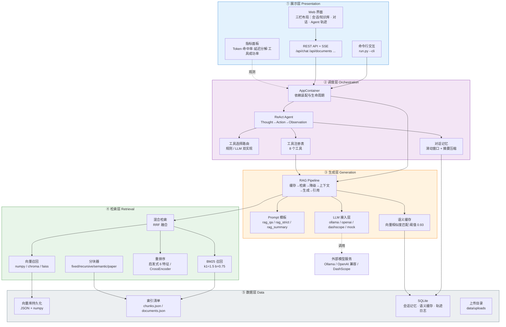
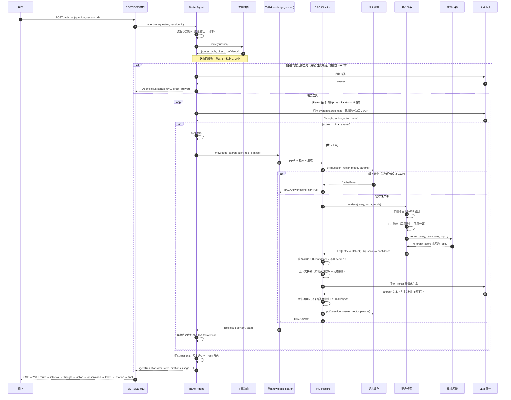
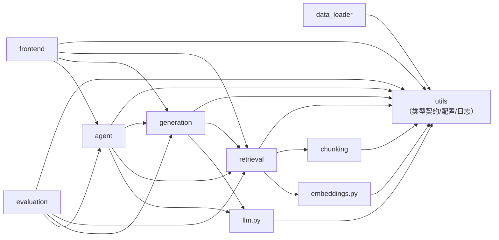

# 智能科研助理 —— 技术设计文档

> 基于 RAG + Agent 的论文知识库问答系统
>
> 版本 1.0　|　文档类型：技术设计说明书

---

## 目录

1. [需求与设计目标](#一需求与设计目标)
2. [系统总体架构](#二系统总体架构)
3. [一次问答的完整数据流](#三一次问答的完整数据流)
4. [模块划分与职责](#四模块划分与职责)
5. [模块接口定义](#五模块接口定义)
6. [核心数据结构](#六核心数据结构)
7. [配置文件说明](#七配置文件说明)
8. [关键算法说明](#八关键算法说明)
9. [专题：三个分数的设计（本项目最重要的一次修复）](#九专题三个分数的设计本项目最重要的一次修复)
10. [关键设计决策与权衡](#十关键设计决策与权衡)
11. [已知限制与后续演进方向](#十一已知限制与后续演进方向)

---

## 一、需求与设计目标

### 1.1 问题背景

科研人员阅读文献时面临的典型困难不是"找不到论文"，而是"读了记不住、想对比查不到、引用找不到原文页码"。通用大模型能流畅作答，但在科研场景下有两个致命缺陷：

1. **无法核查**：模型给出的实验数字、数据集名称、超参数往往与原文不符，而用户无从验证；
2. **无法定位**：即使答案正确，也无法回到原文的具体段落与页码。

因此本系统的设计目标不是"让回答更流畅"，而是**让回答可核查、可追溯、可复现**。所有技术选型都服从这一目标。

### 1.2 功能性需求

| 编号 | 需求 | 对应实现 |
| --- | --- | --- |
| F1 | 多格式论文导入（PDF / DOCX / TXT / MD / CSV / JSON / BIB） | 模块一 `src/data_loader` |
| F2 | 面向学术论文的分块（保公式、剔参考文献、修复跨行断词） | 模块一 `src/chunking` |
| F3 | 混合检索：向量召回 ‖ BM25 召回 → RRF 融合 → 重排序 | 模块一 `src/retrieval` |
| F4 | 带引用溯源的答案生成（`【文档名 p.页码】`） | 模块二 `src/generation` |
| F5 | 三档降级策略（无结果 / 相关性过低 / 模型调用失败） | 模块二 `rag_pipeline.py` |
| F6 | 语义缓存（换个说法问同一件事也能命中） | 模块二 `cache.py` |
| F7 | Agent 自主决策：ReAct 循环 + 8 个工具 + 工具选择路由 | 模块三 `src/agent` |
| F8 | 多轮记忆：会话隔离 + 滑动窗口 + 摘要压缩 | 模块三 `memory.py` |
| F9 | Web 界面：知识库管理 / 对话 / Agent 轨迹 / 指标面板 | 模块四 `src/frontend` |
| F10 | 评测：50+ 问答对、三档检索对比、Bad Case 分析、报告导出 | 模块五 `src/evaluation` |

### 1.3 非功能性需求

| 编号 | 需求 | 说明 |
| --- | --- | --- |
| N1 | **零依赖可运行** | 除 NumPy 外不强制任何第三方库。PDF 解析、BM25、向量检索、Web 服务全部用标准库实现 |
| N2 | **可复现** | 同一输入在相同配置下必须给出相同结果；评测索引建在临时目录，绝不污染用户数据 |
| N3 | **可观测** | 每次问答的 Token、耗时分解、检索命中率、工具调用全部落盘（JSONL）+ 可视化 |
| N4 | **可降级** | 任何外部依赖（LLM / 向量库 / 重排序）不可用时，系统必须仍能给出**有依据**的结果，而不是抛异常 |
| N5 | **模块松耦合** | 模块之间只通过 `src/utils/types.py` 的 dataclass 契约交换数据，任一模块可整体替换 |

---

## 二、系统总体架构

系统采用**五层架构**。分层的核心判据是"**变更的原因是否相同**"：换一个向量库不应该影响提示词，换一个提示词模板不应该影响检索逻辑。



### 2.1 架构约束

1. **依赖单向**：`展示层 → 调度层 → 生成层 → 检索层 → 数据层`，反向依赖一律禁止。评测模块（模块五）可以导入检索/生成/Agent，但业务代码不得导入评测模块 —— 保证评测代码不污染运行时。
2. **契约集中**：跨层传递的数据结构统一定义在 `src/utils/types.py`，共 16 个 dataclass。任何模块内部实现可以整体重写，只要这些结构不变。
3. **降级不是异常**：所有外部依赖失败都被转成"带说明的正常返回值"（`RAGAnswer.degraded=True` / `ToolResult(status=ERROR)`），而不是向上抛异常。这是 N4 的落地方式。

---

## 三、一次问答的完整数据流

下面是"用户提问 → 得到带引用的答案"的完整时序。注意三个关键分支：**缓存命中**（跳过全部计算）、**Agent 路由直接作答**（跳过工具循环）、**降级**（检索无结果或相关性过低）。



### 3.1 关键分支说明

| 分支 | 触发条件 | 效果 |
| --- | --- | --- |
| 缓存命中 | 问题向量与历史问题的余弦相似度 ≥ `generation.cache.similarity_threshold`（0.93），且 model / params 一致 | 跳过检索与生成，`cache_hit=True`，延迟从百毫秒级降到毫秒级 |
| 路由直接作答 | 命中寒暄类模式且置信度 ≥ 0.75 | `iterations=0`，跳过整个 ReAct 循环 |
| 降级 `no_result` | 检索结果为空 | 改用 `NO_CONTEXT_PROMPT`，明确告知"知识库未命中"，不编造引用 |
| 降级 `low_relevance` | `max(confidence) < retrieval.low_relevance_threshold`（0.25） | 上下文前加"相关度较低，请谨慎使用"提示，仍展示实际检索内容 |
| 降级 `llm_error` | LLM 调用抛异常 | 返回友好错误 + 可操作建议（如"请确认已 `ollama serve`"），检索结果仍可点开查看 |
| 死循环终止 | 连续 `loop_detect_window` 轮出现完全相同的 `(action, args)` 指纹 | 强制终止并用已有观察收尾，而不是丢弃已检索到的资料 |
| 超轮次终止 | 达到 `agent.max_iterations` | 触发"强制收尾"：再调一次 LLM 基于已收集的观察生成答案 |

---

## 四、模块划分与职责

`src/` 下共 9 个包（8 个功能包 + 1 个 Web 服务包）。

```
src/
├── data_loader/     模块一-A  多格式文档加载
├── chunking/        模块一-B  文本分块策略
├── retrieval/       模块一-C  向量库 / BM25 / 混合检索 / 重排序 / 引擎门面
├── generation/      模块二    RAG 流水线 / Prompt / 语义缓存 / 流式输出
├── agent/           模块三    ReAct 循环 / 工具 / 路由 / 记忆
├── frontend/        模块四    REST 服务 + SSE + 静态前端 + CLI
├── utils/           基础层    配置 / 类型契约 / 日志与指标 / 存储 / 文本工具
├── evaluation/      模块五    指标库 / 评测集 / 基准测试 / Bad Case / 报告
├── llm.py           基础层    统一 LLM 接入（4 种后端）
└── embeddings.py    基础层    向量化（hash / ollama / openai / local）
```

### 4.1 各包职责与关键文件

| 包 | 关键文件 | 职责 | 对外主入口 |
| --- | --- | --- | --- |
| `utils` | `types.py` `config.py` `logger.py` `storage.py` `text.py` | 数据契约、分层配置、结构化日志与指标、原子写与 SQLite 连接池、分词/切句/关键词 | `load_config` `get_logger` `write_json` |
| `data_loader` | `loader.py` `pdf_loader.py` `docx_loader.py` `text_loader.py` | 按后缀选择加载器；PDF 多后端降级（pymupdf→pdfplumber→pypdf→builtin）；元信息抽取（标题/作者/年份/DOI） | `DocumentLoader` `loader_from_config` |
| `chunking` | `strategies.py` | 四种策略：定长 / 递归 / 语义 / 论文专用；论文优化含剔参考文献、保公式行、跨页合并、断词修复 | `create_chunker` |
| `retrieval` | `vector_store.py` `bm25_retriever.py` `hybrid_retriever.py` `reranker.py` `engine.py` | 向量库三后端；BM25 Okapi；RRF 融合；重排序四后端；`RetrievalEngine` 总装门面（索引/检索/评估） | `create_retrieval_engine` |
| `generation` | `rag_pipeline.py` `prompt_template.py` `cache.py` `streaming.py` | 缓存→检索→降级→上下文→生成→引用解析；四套 Prompt 模板；语义缓存三层查找；SSE 流式事件 | `create_rag_pipeline` |
| `agent` | `react_loop.py` `base_tool.py` `tools.py` `router.py` `memory.py` `prompts.py` | 手写 ReAct 循环；工具抽象与注册表；8 个工具；规则/LLM 路由；会话记忆与摘要压缩 | `create_agent` `build_default_registry` |
| `frontend` | `server.py` `app.py` `static/` | 纯标准库 HTTP 服务 + SSE；22 个 REST 路由；三栏 Web 界面；CLI 交互模式 | `main` (`python run.py`) |
| `evaluation` | `metrics.py` `eval_set.py` `benchmark.py` `badcase.py` `report.py` `chunking_experiment.py` | 纯函数指标库（14 个指标）；61 条评测集；三档对比 + Agent + 全链路基准；四类失败分类与对照实验；报告生成；四种分块策略横向对比 | `generate_reports` `run_full_benchmark` |

### 4.2 模块间依赖关系



**依赖规则的验证方式**：`evaluation` 是唯一的"叶子消费者"，没有任何业务模块导入它 —— 因此可以把评测模块整体删掉而不影响系统运行。

---

## 五、模块接口定义

### 5.1 签名一致性约定（重要）

**所有工厂函数的第一个参数都是 `config`**，这是全项目强制遵守的约定：

```python
create_retrieval_engine(config=None, ...)
create_embedder(config=None, ...)
create_vector_store(config=None, *, backend=None, ...)
create_chunker(config=None, *, strategy=None, ...)
create_reranker(config=None, provider=None, ...)     # provider 位置参数
create_rag_pipeline(config=None, ...)
create_agent(config=None, ...)
create_memory(config=None, ...)
create_router(config=None, ...)
create_cache(config=None, ...)
create_llm(config=None, provider=None, ...)
```

其中 `create_vector_store` / `create_chunker` 的其余可选参数是 **keyword-only**（签名中有 `*` 分隔符）。这不是风格偏好，而是**防误用设计**：

```python
# ❌ 如果没有 keyword-only，这样写不会报错，但会把"内容"当成分块策略：
chunker = create_chunker("semantic")
# ✅ 有 keyword-only 时会直接抛 TypeError，错误在调用点暴露：
create_chunker("semantic")          # TypeError: takes 1 positional argument
create_chunker(strategy="semantic") # 正确
```

配置对象是一个"什么都能传进去"的鸭子类型（`Config` 支持任意属性访问），一旦被当作策略名/后端名传下去，错误会推迟到很远的地方才爆发，且现象与根因毫无关系。`*` 让这类错误在**调用点**就失败。

### 5.2 数据层接口

#### `DocumentLoader`

```python
class DocumentLoader:
    def __init__(
        self,
        pdf_backend: str = "auto",          # auto|pymupdf|pdfplumber|pypdf|builtin
        drop_header_footer: bool = True,    # 是否剔除页眉页脚
        prefer_python_docx: bool = False,
        text_strategy: Optional[str] = None,
    ) -> None: ...

    def load(self, path: Any, doc_id: Optional[str] = None) -> LoadedDocument: ...
```

- **参数**：`pdf_backend="auto"` 表示按 `pymupdf → pdfplumber → pypdf → builtin` 顺序选择**当前环境实际可用**的后端。
- **返回**：`LoadedDocument`（含全文、按页文本、元信息、加载错误列表、实际使用的加载器名）。
- **异常**：不抛。解析失败时把原因写入 `LoadedDocument.load_errors`，`text` 为空字符串。

#### `create_chunker`

```python
def create_chunker(
    config: Any = None,
    *,
    strategy: Optional[str] = None,     # fixed|recursive|semantic|paper
    chunk_size: Optional[int] = None,
    chunk_overlap: Optional[int] = None,
    embedder: Optional[Any] = None,     # semantic 策略需要它算句间相似度
) -> BaseChunker: ...
```

`BaseChunker.split(document: LoadedDocument) -> List[Chunk]` —— 输入加载结果，输出带 `chunk_id`/`page`/`offset`/`strategy` 的分块列表。

### 5.3 检索层接口

#### `create_retrieval_engine` / `RetrievalEngine`

```python
def create_retrieval_engine(
    config: Any = None,
    embedder: Optional[Any] = None,
    reranker: Optional[Any] = None,
    vector_store: Optional[BaseVectorStore] = None,
    chunk_corpus: Optional[Sequence[Chunk]] = None,   # 用于拟合重排序器的 IDF
    **kwargs: Any,
) -> RetrievalEngine: ...
```

`RetrievalEngine` 的主要方法：

| 方法 | 签名 | 说明 |
| --- | --- | --- |
| `index_document` | `(document, strategy=None, reindex=True, progress=None) -> Dict` | 单文档索引；`reindex=True` 时先删旧数据保证幂等；`progress` 回调收 `{"stage","percent","message"}` |
| `index_documents` | `(documents, strategy=None, on_progress=None) -> Dict` | 批量索引，返回 `{num_documents, succeeded, failed, num_chunks, reports}` |
| `retrieve` | `(query, top_k=None, mode=None, candidate_k=None) -> List[RetrievedChunk]` | `mode` ∈ `vector` / `hybrid` / `full` |
| `retrieve_with_context` | `(query, top_k=None, mode=None) -> Dict` | 返回含 `results`（每条的 score + confidence + route + preview）与 `trace` 的完整上下文 |
| `delete_document` | `(doc_id, persist=True) -> int` | 同步删除向量库、BM25 与清单 |
| `evaluate` | `(eval_set, mode="full", top_k=5, match="chunk_id", on_progress=None) -> EvalMetrics` | 检索质量评估 |
| `compare_modes` | `(eval_set, modes=("vector","hybrid","full"), top_k=5, match="chunk_id") -> Dict` | 三档对比实验 |
| `stats` / `health_check` | `() -> Dict` | 状态与健康检查 |

**属性**：`num_chunks`、`num_documents`、`chunks`、`documents()`。

**`evaluate` 的 `match` 参数**（判定相关性的三种口径）：

| 取值 | 含义 | 备注 |
| --- | --- | --- |
| `chunk_id` | 金标准直接给出 chunk_id | 最精确。**注意**：当金标准是 doc_id 而非 chunk_id 时，实现会尝试把该文档下的 chunk 展开为相关集 |
| `doc_id` | 金标准给出文档 ID | 粗粒度，只判断"文档找对了没有" |
| `text` | 金标准给出参考文本片段，用 4-gram 字符重合度 ≥ 0.5 判定 | 评测集 `gold_texts` 用的就是这种 |

> ⚠️ **口径提醒**：`match="text"` 时，`evaluate()` 内部会先取 `max(top_k, 10)` 条再判定金标准文本是否被覆盖。也就是说，它实际度量的是"**Top-10 内是否命中**"，而不是严格的 Top-5。模块五因此额外实现了严格口径（只用真实返回的前 `top_k` 条 + 金标准文本精确归属的 chunk_id），并在报告中把两个口径并列给出。

#### `rrf_fuse`

```python
def rrf_fuse(
    ranked_lists: Sequence[Tuple[str, Sequence[Any]]],   # [("vector", [...]), ("bm25", [...])]
    k: int = 60,
    weights: Optional[Sequence[float]] = None,
    key: str = "chunk_id",
) -> List[Tuple[str, float, Dict[str, int]]]: ...
```

返回 `[(item_key, fused_score, {route: rank}), ...]`，按融合分数降序。

### 5.4 生成层接口

```python
def create_rag_pipeline(
    config: Any = None,
    retrieval_engine: Any = None,
    llm: Any = None,
    cache: Optional[Any] = None,
    **kwargs: Any,
) -> RAGPipeline: ...
```

`RAGPipeline` 的核心方法：

```python
def answer(
    self,
    question: str,
    top_k: Optional[int] = None,
    mode: Optional[str] = None,
    prompt_name: Optional[str] = None,       # rag_qa | rag_strict | rag_summary | no_context
    use_cache: Optional[bool] = None,
    history: Optional[Sequence[Message]] = None,
    trace_extra: Optional[Dict[str, Any]] = None,
) -> RAGAnswer: ...

def answer_stream(self, question: str, ...) -> Iterator[StreamEvent]: ...

def stats(self) -> Dict[str, Any]: ...      # cache_hit_rate / degrade_rate
def health_check(self) -> Dict[str, Any]: ...
def clear_cache(self) -> int: ...
```

**异常约定**：`answer()` **永不抛异常**。空问题返回 `degraded=True, degrade_reason="empty_question"`；LLM 失败返回 `degrade_reason="llm_error"` 并附带可操作建议。

### 5.5 Agent 层接口

```python
def create_agent(
    config: Any = None,
    registry: Optional[ToolRegistry] = None,
    llm: Any = None,
    memory: Optional[Any] = None,
    router: Optional[Any] = None,
    retrieval_engine: Any = None,
    **kwargs: Any,
) -> ReActAgent: ...
```

```python
class ReActAgent:
    def run(
        self,
        question: str,
        session_id: str = "",
        history: Optional[Sequence[Message]] = None,
        context: Optional[Dict[str, Any]] = None,
        on_step: Optional[Callable[[AgentStep], None]] = None,   # 前端 SSE 实时推送轨迹
    ) -> AgentResult: ...

    def stats(self) -> Dict[str, Any]: ...        # loop_rate / json_retry_rate / 工具统计
    def health_check(self) -> Dict[str, Any]: ...
```

**工具契约**：

```python
class BaseTool(ABC):
    name: str = ""                       # LLM 通过它调用
    description: str = ""                # 直接决定路由与选择准确率
    parameters: List[ToolParameter] = []
    examples: List[str] = []
    enabled: bool = True

    @abstractmethod
    def execute(self, **kwargs: Any) -> Any: ...   # str | dict | list | (text, data)

    def run(self, call: Optional[ToolCall] = None, **kwargs: Any) -> ToolResult: ...  # 永不抛异常
    def validate(self, kwargs: Mapping[str, Any]) -> Dict[str, Any]: ...              # 类型转换 + 必填校验
    def render_for_prompt(self, max_examples: int = 1) -> str: ...
```

`ToolRegistry.execute(call)` 在工具不存在或不可用时返回明确的错误 `ToolResult`，而不是抛 `KeyError` —— 这是 Agent"错误恢复"能生效的前提。

### 5.6 评测层接口（模块五）

```python
# 指标（纯函数）
hit_at_k(ranked, gold, k) -> float
mrr(ranked, gold) -> float
recall_at_k(ranked, gold, k) -> float
precision_at_k(ranked, gold, k) -> float
ndcg_at_k(ranked, gold, k) -> float
map_at_k(ranked, gold, k) -> float
citation_accuracy(answer, citations, available_sources) -> Dict   # {total, valid, invalid, accuracy, hallucinated, unresolvable}
citation_coverage(answer, min_sentence_chars=15) -> Dict
answer_relevance(answer, question) -> float
faithfulness(answer, contexts, n=4, threshold=0.6) -> Dict
token_f1(prediction, reference) -> float
exact_match(prediction, reference) -> float
rouge_l(prediction, reference) -> float
aggregate(rows, keys=None, percentiles=(95.0,)) -> Dict

# 评测集
build_eval_set() -> List[Dict]            # 61 条
save_eval_set(items, path=None) -> Path
load_eval_set(path=None) -> List[Dict]
validate_eval_set(items, min_items=60, check_types=True) -> Dict

# 基准测试
prepare_corpus(config=None, keep_dir=False) -> CorpusBundle
RetrievalBenchmark(engine, eval_set, top_k=5, match="text").run(modes=("vector","hybrid","full")) -> Dict
AgentBenchmark(agent, eval_set, limit=15).run(session_prefix="eval") -> Dict
EndToEndBenchmark(pipeline, eval_set, limit=30, repeat=True).run() -> Dict
run_full_benchmark(config=None, quick=False, run_agent=True, run_end_to_end=True, eval_set=None) -> Dict
export_excel(results, path=None, config=None) -> Optional[Path]     # openpyxl 缺失时返回 None

# Bad Case
classify_badcase(sample, retrieval_result=None, agent_result=None, retrieval_hit=None, reference_answer=None) -> List[BadCase]
analyze(retrieval_metrics=None, agent_results=None, eval_set=None, retrieval_details=None, end_to_end_details=None) -> BadCaseReport
optimization_experiment(config=None, eval_set=None, limit=15, baseline=None, optimized=None) -> Dict
save_markdown(report, path=None, config=None) -> Path

# 报告
generate_reports(config=None, quick=False, run_agent=True, with_experiment=True) -> Dict
```

---

## 六、核心数据结构

全部定义在 `src/utils/types.py`，共 16 个 dataclass + 3 个枚举。它们都继承 `_JsonMixin`，统一提供 `to_dict()` / `to_json()` / `from_dict()`。

### 6.1 枚举

```python
class Role(str, Enum):        # 对话角色
    SYSTEM = "system"; USER = "user"; ASSISTANT = "assistant"; TOOL = "tool"

class ToolStatus(str, Enum):  # 工具调用状态
    SUCCESS = "success"; ERROR = "error"; TIMEOUT = "timeout"; SKIPPED = "skipped"

class StepType(str, Enum):    # Agent 单步类型
    THOUGHT = "thought"; ACTION = "action"; OBSERVATION = "observation"
    FINAL = "final"; ERROR = "error"
    ROUTE = "route"           # 规则路由决策
    SUMMARY = "summary"       # 记忆压缩摘要
```

### 6.2 `DocumentMeta` / `LoadedDocument` / `Chunk`

```python
@dataclass
class DocumentMeta(_JsonMixin):
    doc_id: str = ""
    title: str = ""
    authors: List[str] = field(default_factory=list)
    year: Optional[int] = None
    abstract: str = ""
    keywords: List[str] = field(default_factory=list)
    doi: str = ""
    venue: str = ""                       # 发表会议/期刊
    source_path: str = ""
    file_type: str = ""                   # pdf | docx | txt | md
    file_size: int = 0
    num_pages: int = 0
    num_chunks: int = 0
    language: str = "zh"
    created_at: float = field(default_factory=time.time)
    extra: Dict[str, Any] = field(default_factory=dict)

    def short_ref(self) -> str: ...        # "Attention Is All You Need (2017)"
```

```python
@dataclass
class LoadedDocument(_JsonMixin):
    doc_id: str = ""
    text: str = ""                                  # 全文纯文本
    pages: List[str] = field(default_factory=list)  # 按页/节的文本（页码溯源用）
    meta: DocumentMeta = field(default_factory=DocumentMeta)
    load_errors: List[str] = field(default_factory=list)
    loader: str = ""                                # 实际使用的加载器名

    def page_of_offset(self, offset: int) -> int: ...   # 全文偏移 → 页码（1-based）
```

```python
@dataclass
class Chunk(_JsonMixin):
    chunk_id: str = ""        # 为空时在 __post_init__ 用 stable_hash 生成
    doc_id: str = ""
    text: str = ""
    index: int = 0            # 文档内顺序号
    page: int = 1
    start_offset: int = 0
    end_offset: int = 0
    strategy: str = "recursive"
    source: str = ""          # 文档标题/文件名（展示与引用用）
    metadata: Dict[str, Any] = field(default_factory=dict)

    @property
    def num_chars(self) -> int: ...
    def to_embed_text(self) -> str: ...     # 送入 Embedding 的文本（可选加标题前缀）
```

### 6.3 `RetrievedChunk` —— 三个分数的载体

```python
@dataclass
class RetrievedChunk(_JsonMixin):
    chunk: Chunk = field(default_factory=Chunk)
    score: float = 0.0          # 相对展示分（min-max 归一化 0~1，Top-1 恒为 1.0）
    confidence: float = 0.0     # 绝对相关性置信度（降级判定必须用它）
    vector_score: float = 0.0   # 向量相似度
    bm25_score: float = 0.0     # BM25 分数（归一化后）
    rerank_score: float = 0.0   # 重排序原始分数
    vector_rank: int = 0        # 向量路排名（0 表示未命中）
    bm25_rank: int = 0          # BM25 路排名（0 表示未命中）
    source_route: str = ""      # vector | bm25 | hybrid | rerank | hybrid+rerank

    @property
    def text(self) -> str: ...
    @property
    def citation_label(self) -> str: ...    # "文档名 p.页码"
```

> 这三个分数的语义差异是项目中最容易误用的地方，详见[第九章](#九专题三个分数的设计本项目最重要的一次修复)。

### 6.4 `Citation` / `RAGAnswer`

```python
@dataclass
class Citation(_JsonMixin):
    index: int = 0             # 答案中的引用编号 [1][2]
    chunk_id: str = ""
    doc_id: str = ""
    source: str = ""
    page: int = 0
    snippet: str = ""
    score: float = 0.0

    def label(self) -> str: ...    # "文档名 p.页码"
```

```python
@dataclass
class RAGAnswer(_JsonMixin):
    question: str = ""
    answer: str = ""
    citations: List[Citation] = field(default_factory=list)
    retrieved: List[RetrievedChunk] = field(default_factory=list)
    usage: TokenUsage = field(default_factory=TokenUsage)
    latency_ms: float = 0.0
    retrieval_ms: float = 0.0
    generation_ms: float = 0.0
    cache_hit: bool = False
    degraded: bool = False              # 是否触发降级
    degrade_reason: str = ""            # no_result | low_relevance | llm_error | empty_question
    model: str = ""
    prompt_preview: str = ""
    trace_id: str = field(default_factory=lambda: new_id("trace_"))

    @property
    def top_score(self) -> float: ...        # Top-1 的相对展示分（归一化后恒为 1.0）
    @property
    def top_confidence(self) -> float: ...   # Top-1 的绝对相关度（质量评估用这个）
    @property
    def hit(self) -> bool: ...               # 是否有检索结果
```

### 6.5 Agent 相关结构

```python
@dataclass
class ToolCall(_JsonMixin):
    call_id: str = field(default_factory=lambda: new_id("call_"))
    name: str = ""
    args: Dict[str, Any] = field(default_factory=dict)
    thought: str = ""              # 触发该调用的推理
    round: int = 0
    parallel_group: str = ""       # 同一批并行调用的组 ID

    def signature(self) -> str: ...    # 调用指纹（name + 排序后的 args），死循环检测用

@dataclass
class ToolResult(_JsonMixin):
    call_id: str = ""
    name: str = ""
    status: ToolStatus = ToolStatus.SUCCESS
    content: str = ""              # 文本化观察结果（回填给 LLM）
    data: Any = None               # 结构化结果（前端渲染用）
    error: str = ""
    latency_ms: float = 0.0
    retries: int = 0
    usage: TokenUsage = field(default_factory=TokenUsage)

    @property
    def ok(self) -> bool: ...

@dataclass
class AgentStep(_JsonMixin):
    index: int = 0
    type: StepType = StepType.THOUGHT
    content: str = ""
    tool_name: str = ""
    tool_args: Dict[str, Any] = field(default_factory=dict)
    tool_result: Optional[ToolResult] = None
    latency_ms: float = 0.0
    usage: TokenUsage = field(default_factory=TokenUsage)
    round: int = 0

    def render(self) -> str: ...     # 人类可读单行摘要

@dataclass
class AgentResult(_JsonMixin):
    question: str = ""
    answer: str = ""
    steps: List[AgentStep] = field(default_factory=list)
    citations: List[Citation] = field(default_factory=list)
    usage: TokenUsage = field(default_factory=TokenUsage)
    iterations: int = 0
    tool_calls: int = 0
    tool_success: int = 0
    tool_failures: int = 0
    latency_ms: float = 0.0
    terminated_reason: str = "final_answer"   # final_answer|max_iterations|loop_detected|parse_error|direct_answer|error
    routed_tools: List[str] = field(default_factory=list)
    cache_hit: bool = False
    degraded: bool = False
    session_id: str = ""
    trace_id: str = field(default_factory=lambda: new_id("atrace_"))

    @property
    def tool_success_rate(self) -> float: ...
    def trajectory(self) -> List[Dict[str, Any]]: ...   # 前端轨迹树用的精简结构
```

### 6.6 会话、记忆与 Token

```python
@dataclass
class Message(_JsonMixin):
    role: Role = Role.USER
    content: str = ""
    name: Optional[str] = None                # 工具名/发言者名
    tool_call_id: Optional[str] = None
    tool_calls: Optional[List[Dict[str, Any]]] = None
    timestamp: float = field(default_factory=time.time)
    metadata: Dict[str, Any] = field(default_factory=dict)

    # 便捷构造：Message.system/user/assistant/tool(...)
    def to_llm_dict(self) -> Dict[str, Any]: ...   # 去掉本地字段，省 token

@dataclass
class TokenUsage(_JsonMixin):
    prompt_tokens: int = 0
    completion_tokens: int = 0
    total_tokens: int = 0
    estimated: bool = True        # 无真实 tokenizer 时为 True（按字符数估算）
    cost_yuan: float = 0.0

@dataclass
class ConversationTurn(_JsonMixin):
    turn_id: str = field(default_factory=lambda: new_id("turn_"))
    session_id: str = ""
    question: str = ""
    answer: str = ""
    citations: List[Citation] = field(default_factory=list)
    trajectory: List[Dict[str, Any]] = field(default_factory=list)
    usage: TokenUsage = field(default_factory=TokenUsage)
    latency_ms: float = 0.0
    timestamp: float = field(default_factory=time.time)
    feedback: Optional[str] = None      # up | down
    metadata: Dict[str, Any] = field(default_factory=dict)

@dataclass
class Session(_JsonMixin):
    session_id: str = field(default_factory=lambda: new_id("sess_"))
    title: str = "新会话"
    created_at: float = field(default_factory=time.time)
    updated_at: float = field(default_factory=time.time)
    turns: List[ConversationTurn] = field(default_factory=list)
    summary: str = ""                   # 长对话摘要压缩结果
    metadata: Dict[str, Any] = field(default_factory=dict)

    @property
    def num_turns(self) -> int: ...
```

### 6.7 通用工具函数

```python
new_id(prefix: str = "") -> str                 # "call_3f2a1b9c"
stable_hash(text: str, length: int = 16) -> str # 稳定内容哈希（幂等去重）
to_jsonable(obj) -> Any                         # dataclass/Enum/Path → 可序列化结构
from_dict(cls, data) -> Any                     # 从 dict 还原 dataclass（容忍缺字段/多余字段）
```

---

## 七、配置文件说明

配置文件为项目根目录的 `config.yaml`。**优先级（从低到高）**：

```
内置 DEFAULTS  <  config.yaml  <  环境变量 APP_*  <  代码中显式传参
```

环境变量命名规则：`APP_<段名>__<字段名>`（双下划线表示层级），例如：

```bash
APP_LLM__PROVIDER=ollama
APP_RETRIEVAL__TOP_K=10
APP_EMBEDDING__PROVIDER=ollama
```

`Config` 对象支持链式属性访问 `cfg.retrieval.top_k` 与点号路径查询 `cfg.get("retrieval.top_k", 5)`。注意：**属性访问优先级为"类成员 > 配置键"**，所以 `cfg.get` 永远是方法；要读取名为 `get` 的配置键需用 `cfg["get"]`。

### 7.1 `llm` —— 大模型服务

| 键 | 默认值 | 说明 |
| --- | --- | --- |
| `provider` | `mock` | `ollama` 本地 / `openai` 任意 OpenAI 兼容接口 / `dashscope` 通义原生 / `mock` 离线模拟 |
| `model` | `qwen2.5:7b` | 模型名，需与 provider 侧的模型标识一致 |
| `base_url` | `http://127.0.0.1:11434` | 服务地址；`openai` 模式下会自动补 `/v1` |
| `api_key` | `""` | 云端服务的密钥；本地服务留空 |
| `temperature` | `0.3` | 科研问答偏低，减少自由发挥 |
| `top_p` | `0.9` | 核采样 |
| `max_tokens` | `1024` | 单次生成上限 |
| `timeout` | `120` | 单次请求超时（秒） |
| `max_retries` | `3` | 失败重试次数（指数退避，已吐字则不重试） |
| `stream` | `true` | 是否流式输出（前端打字机效果） |

### 7.2 `embedding` —— 向量化

| 键 | 默认值 | 说明 |
| --- | --- | --- |
| `provider` | `hash` | `hash` 离线哈希 n-gram（零依赖、确定性）/ `ollama` / `openai` / `local`（sentence-transformers） |
| `model` | `bge-large-zh` | 模型名；`hash` 模式下仅作标识 |
| `base_url` / `api_key` | — | 远程服务的地址与密钥 |
| `dimension` | `512` | 向量维度。**换 Embedding 模型后必须重建索引** |
| `batch_size` | `32` | 批量编码大小 |
| `normalize` | `true` | 是否 L2 归一化（归一化后余弦相似度可用点积算） |
| `cache_dir` | `./data/models` | 本地模型缓存目录（`provider=local` 时生效） |

### 7.3 `vector_store` —— 向量数据库

| 键 | 默认值 | 说明 |
| --- | --- | --- |
| `backend` | `numpy` | `numpy` 纯内存 + JSON 持久化 / `chroma` / `faiss` |
| `persist_dir` | `./data/vector_store` | 持久化目录（相对路径按项目根目录解析） |
| `collection` | `papers` | 集合名（chroma 后端使用） |
| `distance` | `cosine` | `cosine` / `l2` / `ip` |

### 7.4 `chunking` —— 分块

| 键 | 默认值 | 说明 |
| --- | --- | --- |
| `strategy` | `recursive` | `fixed` 定长 / `recursive` 递归（按段落→句子→字符） / `semantic` 语义 / `paper` 论文专用 |
| `chunk_size` | `512` | 目标块大小（字符） |
| `chunk_overlap` | `64` | 相邻块重叠字符数，防止答案被切断 |
| `min_chunk_size` | `80` | 小于此长度的块会被合并 |
| `semantic.similarity_threshold` | `0.62` | 语义分块的相邻句相似度阈值：低于它则切分 |
| `semantic.max_sentences` | `12` | 单个语义块的最大句数（硬上限，防超长块） |
| `paper_optimize.remove_references` | `true` | 剔除参考文献列表（文献条目会污染检索） |
| `paper_optimize.merge_cross_page` | `true` | 合并被分页切断的段落 |
| `paper_optimize.keep_formula_lines` | `true` | 公式行不参与切分 |
| `paper_optimize.dehyphenate` | `true` | 修复跨行断词（`inter-\nnational` → `international`） |

### 7.5 `retrieval` —— 检索

| 键 | 默认值 | 说明 |
| --- | --- | --- |
| `top_k` | `5` | 最终返回给生成层的片段数 |
| `candidate_k` | `20` | 每路召回候选数（送入 RRF 融合与重排序） |
| `enable_bm25` | `true` | 是否启用 BM25 关键词路 |
| `enable_rerank` | `true` | 是否启用重排序 |
| `rrf_k` | `60` | RRF 平滑常数 k。越小越放大头部排名差异 |
| `vector_weight` / `bm25_weight` | `1.0` / `1.0` | 两路在 RRF 中的权重 |
| `bm25_k1` | `1.5` | 词频饱和参数（越大则词频影响越持续） |
| `bm25_b` | `0.75` | 文档长度归一化强度（0=不归一化，1=完全归一化） |
| `min_score` | `0.0` | 低于该分数的结果被丢弃 |
| `low_relevance_threshold` | `0.25` | **低相关性判定阈值**（与 `confidence` 比较），触发 `low_relevance` 降级 |

### 7.6 `data_loader` —— 文档加载

| 键 | 默认值 | 说明 |
| --- | --- | --- |
| `pdf_backend` | `auto` | `auto` 按 `pymupdf → pdfplumber → pypdf → builtin` 顺序选可用后端 |
| `prefer_python_docx` | `false` | DOCX 是否优先用 `python-docx`（默认用内置 zip+xml 解析） |
| `text_strategy` | `null` | 留空表示按文件后缀自动选择（markdown/bibtex/csv/json/plain） |

### 7.7 `reranker` —— 重排序

| 键 | 默认值 | 说明 |
| --- | --- | --- |
| `provider` | `heuristic` | `none` 关闭 / `heuristic` 零依赖启发式 / `ollama` CrossEncoder / `local` 本地 CrossEncoder |
| `model` | `bge-reranker-base` | 远程模型名 |
| `base_url` | `http://127.0.0.1:11434` | 服务地址 |
| `top_n` | `5` | 重排序后保留条数 |

### 7.8 `generation` —— 生成层

| 键 | 默认值 | 说明 |
| --- | --- | --- |
| `max_context_chars` | `6000` | 拼进 Prompt 的最大上下文字符数（超出按相关性截断） |
| `max_chunk_chars` | `1500` | 单个片段最大字符数（超出在句子边界截断） |
| `fallback_to_llm` | `true` | 无检索结果时是否回退纯模型生成 |
| `citation_style` | `【{source} p.{page}】` | 引用格式，必须与 `CITATION_PATTERN` 及前端解析规则一致 |
| `cache.enabled` | `true` | 语义缓存开关 |
| `cache.backend` | `sqlite` | `sqlite` 持久化 / `memory` 纯内存 |
| `cache.path` | `./data/cache/semantic_cache.db` | 缓存数据库路径 |
| `cache.similarity_threshold` | `0.93` | 语义命中阈值：问题向量余弦相似度 ≥ 该值即视为同一问题 |
| `cache.ttl_seconds` | `604800` | 条目有效期（7 天） |
| `cache.max_entries` | `5000` | 容量上限，超出按 LRU 淘汰 |

### 7.9 `agent` —— Agent 决策层

| 键 | 默认值 | 说明 |
| --- | --- | --- |
| `max_iterations` | `8` | 最大推理轮次（防死循环的第一道闸） |
| `max_parallel_tools` | `3` | 单轮最大并行工具数 |
| `tool_timeout` | `45` | 单工具调用超时（秒） |
| `max_retries_per_tool` | `2` | 工具失败重试次数 |
| `enable_router` | `true` | 是否启用规则路由（意图识别，减少无谓推理轮次） |
| `enable_parallel` | `true` | 是否启用并行工具调用 |
| `loop_detect_window` | `2` | 死循环检测窗口：连续 N 轮相同 `(action, args)` 即强制终止 |
| `max_observation_chars` | `2000` | 观察结果截断长度（防 Observation 撑爆上下文） |
| `router_provider` | `rule`（缺省） | `rule` 规则路由 / `llm` LLM 分类路由 / `none` 关闭路由 |

### 7.10 `memory` —— 对话记忆

| 键 | 默认值 | 说明 |
| --- | --- | --- |
| `backend` | `sqlite` | `sqlite` 跨重启存活 / `memory` 纯内存 |
| `path` | `./data/memory/chat.db` | 数据库路径 |
| `max_turns` | `20` | 滑动窗口保留的最大轮次 |
| `max_tokens` | `3000` | 历史消息 Token 预算 |
| `summary_threshold` | `12` | 超过该轮次触发摘要压缩 |
| `keep_recent_after_summary` | `6` | 摘要后保留的最近轮次数 |

### 7.11 `observability` —— 可观测性

| 键 | 默认值 | 说明 |
| --- | --- | --- |
| `log_dir` | `./logs` | 日志目录 |
| `level` | `INFO` | 日志级别（DEBUG/INFO/WARNING/ERROR） |
| `trace_file` | `./logs/traces.jsonl` | 结构化请求日志（JSONL，记录每次问答的 Token/耗时/命中率） |
| `metrics_file` | `./logs/metrics.jsonl` | 指标日志 |
| `console_color` | `true` | 控制台彩色输出 |

### 7.12 `server` —— 服务端

| 键 | 默认值 | 说明 |
| --- | --- | --- |
| `host` | `127.0.0.1` | 监听地址（默认仅本机可访问） |
| `port` | `8501` | 监听端口（被占用时自动顺延） |
| `reload` | `false` | 是否热重载 |
| `cors_origins` | `["*"]` | CORS 白名单 |
| `max_upload_mb` | `100` | 单文件上传大小上限（MB） |

### 7.13 `paths` 与 `web_search`

| 段 | 键 | 默认值 | 说明 |
| --- | --- | --- | --- |
| `paths` | `data_dir` | `./data` | 数据根目录 |
| | `upload_dir` | `./data/uploads` | 上传文件目录 |
| | `index_dir` | `./data/index` | 索引清单目录（`chunks.json` / `documents.json`） |
| | `report_dir` | `./reports` | 评测报告输出目录 |
| `web_search` | `enabled` | `false` | 联网搜索工具开关（关闭时该工具不出现在工具清单里） |
| | `provider` | `duckduckgo` | `duckduckgo` / `tavily` / `serper` |
| | `api_key` | `""` | 云服务密钥 |
| | `max_results` | `5` | 返回结果数 |
| | `timeout` | `15` | 请求超时（秒） |

---

## 八、关键算法说明

### 8.1 RRF 融合（Reciprocal Rank Fusion）

**为什么不用加权分数求和**：向量相似度落在 0~1，BM25 分数无上界（可能是 0.3，也可能是 37.5）。直接加权求和必须先归一化，而归一化对分数分布极其敏感 —— 同一份文档库换一批查询，归一化系数就变了，权重就失去意义。

RRF 的做法是**只用排名，完全丢弃分数绝对值**：

$$
\text{RRF}(d) = \sum_{r \in R} \frac{w_r}{k + \text{rank}_r(d)}
$$

- $R$：召回路径集合（本项目为 `{vector, bm25}`）
- $w_r$：该路径权重（`retrieval.vector_weight` / `bm25_weight`）
- $\text{rank}_r(d)$：文档 $d$ 在第 $r$ 路中的排名（**从 1 开始**）；未出现在该路则为 0 贡献
- $k$：平滑常数（`retrieval.rrf_k`，默认 60）

**$k$ 的作用**：$k$ 越小，$1/(k+\text{rank})$ 随排名下降越快，头部排名的优势被放大。$k=60$ 时，第 1 名与第 2 名的贡献分别是 $1/61$ 与 $1/62$ —— 差异很小，说明 RRF 更看重"**多路共同命中**"而不是"单路排第一"：

| 情形 | 融合分数（$k=60$，等权） |
| --- | --- |
| 两路都排第 1 | $1/61 + 1/61 \approx 0.0328$ |
| 向量第 1、BM25 未命中 | $1/61 \approx 0.0164$ |
| 两路分别第 3、第 5 | $1/63 + 1/65 \approx 0.0313$ |

最后一行很关键：**"两路都靠前"胜过"单路第一"**。这正是混合检索比纯向量更稳的原因 —— 一个片段如果同时被语义召回和关键词召回认可，它大概率真的相关。

**实现要点**（`src/retrieval/hybrid_retriever.py`）：融合阶段把原始 RRF 分数**暂存**在 `rerank_score` 字段（该字段此时尚未使用），供后续换算 `confidence`，换算完成后清除。

### 8.2 BM25（Okapi BM25）

$$
\text{score}(D, Q) = \sum_{t \in Q} \text{IDF}(t) \cdot \frac{f(t, D) \cdot (k_1 + 1)}{f(t, D) + k_1 \cdot \left(1 - b + b \cdot \frac{|D|}{\text{avgdl}}\right)}
$$

其中 IDF 采用带平滑的概率形式（避免负值）：

$$
\text{IDF}(t) = \ln\left(1 + \frac{N - n_t + 0.5}{n_t + 0.5}\right)
$$

- $N$：语料库文档（分块）总数；$n_t$：包含词项 $t$ 的文档数
- $f(t,D)$：词项 $t$ 在文档 $D$ 中的词频
- $|D|$：文档长度；$\text{avgdl}$：平均文档长度
- $k_1 = 1.5$（`retrieval.bm25_k1`）：**词频饱和速度**。$f$ 很大时分子分母同阶，贡献趋近上限 $(k_1+1)$，防止一个词重复 100 次就霸榜
- $b = 0.75$（`retrieval.bm25_b`）：**长度归一化强度**。$b=0$ 完全不归一化（长文档天然占优），$b=1$ 完全归一化

**在中英混合场景下的作用**：本系统语料是英文论文，但用户会用中文提问（"Transformer 训练用了哪些数据集？"）。离线 `hash` 向量对中英跨语言几乎无信号，此时**中文问题里的英文术语**（`WMT 2014`、`BLEU`、`ImageNet`、`masked language model`）只能靠 BM25 的字面匹配命中。这就是 `enable_bm25=true` 在本项目里不是"锦上添花"而是"必需项"的原因。

**实现要点**（`src/retrieval/bm25_retriever.py`）：IDF 用 `np.zeros(n_terms)` 预计算，分母项 $k_1(1-b+b|D|/\text{avgdl})$ 预计算为 `_denom_base`，打分时只做稀疏更新 —— 单次查询在 27 个分块的语料上耗时 < 2ms。

### 8.3 ReAct 循环（手写实现）

```text
┌─ 1. 规则路由（可选，廉价意图识别，跳过多余推理轮次）
│
├─ 2. 组装 System Prompt（角色 + 工具清单 + 格式约束）
│      + Scratchpad（历史轨迹）+ 当前问题
│
├─ 3. LLM 输出决策 JSON  {thought, action, action_input}
│      └─ 解析失败 → 追加纠正提示重试（最多 json_retries=2 次）
│
├─ 4. action == final_answer ?
│      是 → 结束，返回答案
│      否 → 执行工具
│            ├─ 同名同参重复调用 → 死循环计数 +1
│            ├─ 超时 → 重试（最多 max_retries_per_tool 次）
│            ├─ 异常 → 记录错误观察，提示模型改用其它工具
│            └─ 并行：一轮多个独立工具时用线程池并发执行
│
├─ 5. 观察结果截断（max_observation_chars）后追加进 Scratchpad，回到第 3 步
│
└─ 6. 终止条件：final_answer / max_iterations / loop_detected / parse_error
        达到最大轮次时，用"强制收尾"生成基于已有信息的答案
```

**为什么手写而不用 LangChain**：见[第十章决策 1](#决策-1为什么手写-react-循环而不用-langchain)。

**四个决策优化点**：

1. **工具选择路由**：先用一次零成本的关键词/正则分类（`RuleRouter`，耗时 < 1ms）决定候选工具集，把给模型的工具清单从 8 个缩到 1~3 个。省 Token 的同时显著降低选错概率。
2. **并行工具调用**：模型可在一次响应中给出 `actions` 数组，循环用 `ThreadPoolExecutor` 并发执行；为保持轨迹可读，**执行是并发的，但结果按原始顺序依次追加**。
3. **错误恢复**：超时/异常 → 重试 → 全部失败时在 Observation 末尾追加"请换用其它工具"的提示，让模型自行改道，而不是让循环崩掉。
4. **死循环检测**：把 `(action, sorted(args))` 序列化为指纹，若滑动窗口内重复出现即强制终止，并**用已有信息收尾**（`_fallback_from_scratchpad`）—— 检索到的资料明明在手里，不能因为循环异常就丢弃。

### 8.4 启发式重排序的 6 个特征与相关性门控

零依赖的重排序器 `HeuristicReranker` 用 6 个可解释特征加权求和，再经 sigmoid 压缩：

$$
\text{confidence} = \sigma\left(\sum_i w_i f_i - 1.6\right) \times \text{gate}, \qquad
\sigma(z) = \frac{1}{1 + e^{-z}}
$$

$$
\text{gate} = 0.05 + 0.95\sqrt{\text{coverage}}
$$

| # | 特征 | 权重 | 含义与动机 |
| --- | --- | --- | --- |
| 1 | `coverage` 词项覆盖率 | 1.00 | 查询词项在文档中出现的比例。BM25 的无权重版本，捕捉"是否谈到" |
| 2 | `idf_coverage` IDF 加权覆盖 | 1.60 | 稀有词命中权重更高。"Transformer"命中远比"方法"命中重要 |
| 3 | `proximity` 邻近度 | 0.75 | 命中词项之间的最小字符跨度，$e^{-\text{span}/260}$。距离越近越可能是同一语义单元 |
| 4 | `title_hit` 标题命中 | 0.55 | 文档首 120 字符（标题/章节名）包含查询词项时加分 |
| 5 | `term_match` 术语精确匹配 | 0.90 | 查询中的数字与专有名词（`28.4 BLEU`）在文档中精确出现时加分。**这是向量检索最容易失效、而对科研问答最关键的一类匹配** |
| 6 | `length_prior` 长度先验 | 0.25 | 理想区间 150~900 字符；过短信息不足、过长噪声多 |

**门控（gate）为什么必需**：只在特征层面加权是不够的 —— 一个与问题毫无词项交集、但长度恰好落在理想区间的段落，仍然能靠第 6 个特征拿到约 0.3 的分数。而 `retrieval.low_relevance_threshold` 是 0.25，于是这类无关内容会**逃过低相关性检查**，被当作正常上下文送进 Prompt。

门控把"词项覆盖率"作为乘性因子：$\text{coverage}=0$ 时置信度被压到原来的 5%，彻底趋近 0。这样"知识库里完全没有相关内容"的问题（如"今天天气怎么样"）才会正确触发 `low_relevance` 降级。

**IDF 统计**：重排序器通过 `fit(chunks)` 用全量语料统计 IDF。不调用 `fit` 也能工作（退化为等权覆盖），但区分度明显更差。

### 8.5 语义缓存的相似度匹配

普通 KV 缓存用字符串精确匹配做键，用户把"Transformer 用了什么数据集"换成"Transformer 模型训练用了哪些数据"就会全部击穿。语义缓存改为**向量相似度匹配**。

**三层查找（从快到慢）**：

| 层 | 结构 | 命中耗时 | 说明 |
| --- | --- | --- | --- |
| 1 | 内存 LRU 字典 | < 1ms | 容量 512 条 |
| 2 | SQLite 持久层 | 数 ms | 跨进程/重启存活，向量以 float32 二进制存储 |
| 3 | 向量近邻检索 | 数十 ms | 对候选集（内存 + 数据库前 1000 条）做余弦相似度全扫 |

**匹配条件（三者必须同时满足）**：

1. 余弦相似度 $\ge$ `generation.cache.similarity_threshold`（0.93）；
2. `model` 相同（换模型后旧答案不可复用）；
3. `params` 完全相同（`mode` / `top_k` / `prompt` / `temperature` 序列化后比对）。

**失效策略**：TTL（默认 7 天）+ 容量上限（超出按 LRU 淘汰）+ 按问题前缀/全量清空接口（知识库更新后清缓存）。

**为什么阈值取 0.93 而不是 0.8**：阈值过低会把"Transformer 用了什么数据集"和"BERT 用了什么预训练任务"判成同一问题 —— 两者词面高度相似但答案完全不同。缓存错答比缓存未命中危险得多，所以宁可保守。

### 8.6 滑动窗口 + 摘要压缩

多轮对话的上下文预算管理分三步（`src/agent/memory.py`）：

**第 1 步：滑动窗口（`max_turns=20`）**

只保留最近 20 轮，更早的直接从候选集中排除。

**第 2 步：Token 预算裁剪（`max_tokens=3000`）**

```python
window_turns = session.turns[-max_turns:]
picked, used = [], 0
for turn in reversed(window_turns):          # 从最新一轮往前累加
    pair = [Message.user(turn.question),
            Message.assistant(shorten(turn.answer))]   # assistant 只保留摘要化片段
    pair_tokens = sum(estimate_tokens(m.content) for m in pair)
    if used + pair_tokens > budget and picked:
        truncated = True
        break                                 # 预算耗尽即停止
    picked = pair + picked                    # 保持时间正序
    used += pair_tokens
```

注意"**从最新往前累加**"这个方向：预算不足时牺牲的是**最旧**的对话，而不是最新的 —— 用户当前关心的话题一定能进入上下文。

**第 3 步：摘要压缩（`summary_threshold=12`, `keep_recent_after_summary=6`）**

当轮次超过 12 时，把被挤出窗口的历史交给 LLM（`MEMORY_SUMMARY_PROMPT`）压缩成一段不超过 200 字的摘要，替换原始消息。摘要**必须保留**三类信息：

- 用户关注的核心论文/主题
- 已经确认的关键结论与数字
- 用户明确表达过的偏好或约束（如"只要方法部分"）

**不保留**：寒暄、重复内容、已被推翻的中间结论。

**降级后的提示**：如果发生了裁剪，`get_context()` 会在 `hint` 字段写入"为控制上下文长度，N 条更早的对话已省略，如用户提到早前内容请主动询问"，并把这个提示注入 Prompt —— 让模型知道自己的记忆边界，而不是假装记得。

### 8.7 离线哈希向量化（`HashEmbedder`）

作为零依赖默认向量化方案，它的算法是：

1. **多粒度特征**：中文 unigram / bigram / trigram（trigram 权重 0.5）+ 英文小写词 + 全文词袋 token
2. **Feature hashing**：$h = \text{blake2b}(\text{feature}) \bmod \text{dim}$，符号位由哈希次高位决定（signed hashing，抵消哈希冲突的系统性偏差）
3. **亚线性 TF 加权**：$w = 1 + \log(\text{tf})$，抑制高频词主导
4. **IDF 近似**：对超高频特征（"的"、"方法"、"结果"等）施加固定降权
5. **L2 归一化**：使余弦相似度可直接用点积计算

**能力边界**：它是**词面近似**，没有跨语言能力。中文提问检索英文语料时，只能靠问题中的英文术语（`WMT 2014`、`BLEU`）+ BM25 命中。要真正解决跨语言检索，必须换成 `ollama`（bge-m3）等真实语义向量模型。这个边界在评测报告中有量化体现。

---

## 九、专题：三个分数的设计（本项目最重要的一次修复）

### 9.1 问题现象

早期版本只有 `score` 一个字段，定义为"归一化到 0~1 的相关度分数"。降级判定直接用 `answer.top_score < threshold` 判断相关性过低。

结果出现了严重的功能失效：**"今天天气怎么样"这类与知识库完全无关的问题，也能拿到 1.00 的高分**，`low_relevance` 降级永远不会触发，系统拿着几段完全无关的论文片段去生成答案。

### 9.2 根因

`score` 是 **min-max 归一化后的相对展示分**：

$$
\text{score}_i = \frac{s_i - \min_j s_j}{\max_j s_j - \min_j s_j}
$$

归一化的定义决定了 **Top-1 恒为 1.0** —— 无论检索结果整体有多不相关。它回答的是"**这条比那条好多少**"，而完全不回答"**到底有没有检索到相关内容**"。用相对分做绝对判断，是逻辑上的范畴错误。

### 9.3 修复

拆成两个语义明确的字段，并在类型定义里写清各自用途：

| 字段 | 类型 | 语义 | 取值范围 | 用途 |
| --- | --- | --- | --- | --- |
| `score` | 相对展示分 | 这条比那条好多少 | 0~1，**有结果时 Top-1 恒为 1.0** | 前端画相关度进度条、结果排序 |
| `confidence` | **绝对相关度** | 这条到底有多相关 | 0~1（含义随排序器而定） | **降级判定**、阈值过滤、质量评估 |

`confidence` 的来源按检索档位不同：

| 档位 | `confidence` 的来源 | 量纲 |
| --- | --- | --- |
| `vector` | 向量余弦相似度（裁剪到 0~1） | 余弦相似度 |
| `hybrid` | 归一化 RRF 分数：$\text{raw} / \text{theoretical\_max}$ | 0~1 |
| `full` | 重排序原始分数经 sigmoid + 相关性门控 | 0~1 |

其中 `hybrid` 档的换算有明确物理含义：

- 某 chunk 仅被向量路排第 1（$\text{RRF} = 1/61 \approx 0.0164$）→ `confidence ≈ 0.50`
- 两路都排第 1（$\text{RRF} = 2/61$）→ `confidence ≈ 1.00`
- 两路都是无关结果（RRF 很小）→ `confidence` 同样很小，**正确触发降级**

### 9.4 落地约束

`RAGAnswer` 上对应提供两个属性，命名本身就是提示：

```python
@property
def top_score(self) -> float:
    """Top-1 的相对展示分（归一化，恒为 1.0 当有结果时）。"""
    return self.retrieved[0].score if self.retrieved else 0.0

@property
def top_confidence(self) -> float:
    """Top-1 的绝对相关性置信度 —— **降级判定与质量评估请用这个**。"""
    return self.retrieved[0].confidence if self.retrieved else 0.0
```

降级判定的实现（`src/generation/rag_pipeline.py`）：

```python
def _check_degradation(self, retrieved: Sequence[RetrievedChunk]) -> str:
    if not retrieved:
        return "no_result"
    top_confidence = max(r.confidence for r in retrieved)   # ← 必须用 confidence
    if top_confidence < self.rag.low_relevance_threshold:   # 默认 0.25
        return "low_relevance"
    return ""
```

### 9.5 连带影响

这个修复不只是改一个字段名，它连带影响了三处：

1. **重排序器必须输出有区分度的 `confidence`**：因此引入了 6 特征加权 **+ 相关性门控**（8.4 节）。没有门控，无关段落仍能拿到约 0.3 而逃过 0.25 的阈值。
2. **混合检索必须给出可比的 RRF 归一化**：因此有了 `raw / theoretical_max` 的换算，而不是直接把 RRF 原始分当置信度（原始分量级只有 0.0x，会导致所有结果都被判为低相关）。
3. **评测层的相关性判定必须用 `confidence`**：模块五的 `metrics.py` 与 `badcase.py` 中所有"判断这条检索结果是否相关"的逻辑都读 `confidence`；`score` 只用于展示排序。

### 9.6 教训（可迁移的设计原则）

- **相对量与绝对量必须用不同的字段名承载**。同名共存会让调用方无法判断该用哪个。
- **归一化会破坏绝对语义**。任何经过 min-max / softmax 归一化的分数，都只能用于比较，不能用于阈值判断。
- **降级判定的阈值必须定义在绝对量纲上**，否则阈值本身没有意义。

---

## 十、关键设计决策与权衡

### 决策 1：为什么手写 ReAct 循环而不用 LangChain

**决策**：`src/agent/react_loop.py` 完全手写，不引入任何 Agent 框架。

**理由**：

1. **框架把关键决策藏起来了**。"推理-行动-观察"循环是 AI Agent 的核心机制，但 LangChain 等框架把它封装成 `AgentExecutor`，使用者只能调用而无法理解：提示词怎么组装、轨迹怎么维护、什么时候停、失败了怎么办。本项目的目标是**讲清机制**。
2. **调试成本**：框架的抽象层会在出错时把真实异常包成难懂的框架异常。手写实现里，`json.JSONDecodeError` 就是 `json.JSONDecodeError`。
3. **可控的降级行为**：手写实现能做到"达到最大轮次时用已有观察强制收尾"、"检测到死循环时用已有信息作答"。框架默认行为往往是抛异常或返回空答案，这在科研场景不可接受。

**代价**：需要自己处理 JSON 容错解析、超时、重试、并行、死循环检测 —— 约 700 行代码。**收益**：每个决策点都有注释说明权衡，且行为完全可控。

### 决策 2：为什么拆出 `score` 与 `confidence` 两个分数

见[第九章](#九专题三个分数的设计本项目最重要的一次修复)。核心权衡是**接口简洁性 vs 语义正确性**：单字段的 API 更简单，但它无法同时表达"相对排序"和"绝对相关"。在"降级判定失效"这个具体 bug 面前，简洁性的收益被证明是虚假的。

### 决策 3：为什么零依赖优先

**决策**：除 NumPy 外不强制任何第三方库。PDF 解析、BM25、向量检索、Web 服务、Excel 之外的全部功能都用标准库实现。

**理由**：

1. **可运行性是第一位的**。一份课程作业如果在评审者机器上因为 `pip install` 失败而跑不起来，所有设计都白费。
2. **依赖是负债**：每个依赖都带来版本冲突、平台差异、以及"它自己出了 bug 怎么办"的问题。`pdfplumber` 在某个版本上对大文件会内存爆炸，`chromadb` 在 Windows 上有过 DLL 加载问题 —— 自研的 200 行 PDF 文本抽取器虽然简陋，但行为完全可预测。
3. **降级链自然形成**：`pdf_backend="auto"` 会在 `pymupdf → pdfplumber → pypdf → builtin` 中选可用的；向量库有 `numpy/chroma/faiss` 三后端。**有依赖就用好的，没依赖也能跑**，这是最佳组合。

**代价**：自研组件性能与精度不如成熟库。**缓解**：把差距量化出来 —— 评测报告里明确写出 `builtin` PDF 后端的解析结果（3 篇样例论文 → 27 个分块），并说明"生产环境建议 `pip install pymupdf`"。

### 决策 4：为什么用 RRF 而不是加权分数求和

见 [8.1](#81-rrf-融合reciprocal-rank-fusion)。核心权衡是**信息量 vs 可比性**：加权求和保留了分数幅度信息（理论上更精细），但要求两路分数可比，而向量余弦相似度与 BM25 分数在量纲上根本不可比。RRF 主动放弃幅度信息，换取**跨路可比性与对分数分布的不敏感性** —— 在混合检索场景下这是正确的取舍。

### 决策 5：为什么启发式重排序要加"相关性门控"

见 [8.4](#84-启发式重排序的-6-个特征与相关性门控)。核心权衡是**召回友好 vs 精度友好**：不加门控时，长度合适的无关段落能拿到约 0.3 的分数，对"宁可多给点上下文"是友好的，但会让降级阈值失效。加门控后，无关段落趋近 0，代价是**弱相关段落也可能被压得过低**（覆盖率很小时 gate 很小）。

**这个权衡的实测量化**：模块五的评测显示，启用启发式重排序的 `full` 档在严格 NDCG@5 上并不总是优于 `hybrid` 档 —— 说明门控在某些问题上把正确答案也压低了。这是一个**已知的、有数据支撑的**设计代价，而不是未发现的 bug。评测报告的单参数消融表给出了关闭重排序后的指标变化，供使用者按场景决策。

### 决策 6：没有真实 tokenizer 时如何做 Token 预算

**决策**：`estimate_tokens()` 用字符数经验公式估算（中文约 1.5 字符/token，英文约 4 字符/token），并在 `TokenUsage.estimated` 字段标记为 `True`。

**理由**：真实 tokenizer（tiktoken / sentencepiece）是重依赖且与模型强绑定。滑动窗口与摘要压缩需要的是**量级正确的预算控制**，而不是精确计数。±20% 的误差对"保留最近几轮"的决策没有实质影响。

**代价**：成本核算（`cost_yuan`）有 ±20% 误差。**缓解**：`estimated=True` 字段让消费方知道这不是精确值，前端展示时会带"（估算）"标注。

### 决策 7：为什么把三档降级做成"正常返回值"而不是异常

**决策**：`no_result` / `low_relevance` / `llm_error` 三种降级全部通过 `RAGAnswer.degraded=True` + `degrade_reason` 返回，不抛异常。

**理由**：

1. **降级是预期内的业务状态，不是程序错误**。"知识库里没有这篇论文"是完全正常的用户场景，用异常表达会导致上层必须写 `try/except` 才能处理正常流程。
2. **降级时仍有可用信息**：检索失败时前端仍要展示"我实际检索到了什么"，LLM 失败时检索结果仍然有效可点开。异常会丢失这些上下文。
3. **可观测性**：降级被记为一次正常调用并写入 Trace 日志，可以统计 `degrade_rate`；异常则会被错误处理路径吞掉。

**代价**：调用方必须主动检查 `degraded` 字段，容易漏检。**缓解**：`degraded=True` 时 `answer` 文本本身包含面向用户的说明与建议，即使前端漏检也不会展示空白。

### 决策 8：为什么评测索引建在临时目录

**决策**：`prepare_corpus()` 用 `tempfile.mkdtemp()` 建索引，并覆盖 `vector_store.persist_dir` / `paths.index_dir` / `generation.cache.path` / `memory.path` 四个路径。

**理由**：评测会反复运行（调参、回归测试）。如果评测直接写用户的知识库目录，会污染真实数据、让两次评测互相干扰、并导致"评测结果取决于上次评测残留"这种无法复现的情况。用独立临时目录后，**评测与用户数据完全隔离，且可并行运行**。

**代价**：每次评测都要重新索引（约 0.2 秒 / 27 个分块），且临时目录会残留。**缓解**：索引耗时在评测总耗时中占比极低，可忽略。

### 决策 9：为什么评测同时报告"严格口径"与"引擎口径"

**决策**：模块五的检索对比表并列给出两组数字。

**背景**：`RetrievalEngine.evaluate(match="text")` 内部会先取 `max(top_k, 10)` 条再判定金标准文本是否被覆盖 —— 它实际度量的是"Top-10 内是否命中"。若只报这一组数字，Hit@5 会被系统性高估。

**理由**：只报严格口径会显得与引擎既有输出不一致；只报引擎口径则会高估系统能力。**同时给出并把差距写清楚**，读者才能判断真实水平。报告中实测差距约 0.10（严格 0.80 vs 引擎 0.93）。

---

## 十一、已知限制与后续演进方向

### 11.1 已知限制（均有实测数据支撑）

| # | 限制 | 具体表现 | 根因 | 缓解/出路 |
| --- | --- | --- | --- | --- |
| L1 | **中英跨语言检索能力弱** | 中文提问检索英文语料时，纯中文表述（无英文术语）的问题召回率明显偏低 | 默认 `embedding.provider=hash` 是词面近似，无跨语言语义能力 | 换 `ollama` + bge-m3；评测集里特意保留少量纯中文问题以暴露该局限 |
| L2 | **启发式重排序的置信度区分度不足** | 部分查询下多个候选项得到**完全相同**的 `confidence`（如全部 0.0822） | 6 特征在小语料上易出现特征值并列；门控对低覆盖率查询整体压低 | 修重排序器（引入更多判别特征 / 打破并列）；评测消融表显示关闭重排序在某些问题上反而更好 |
| L3 | **重排序可能返回少于 `top_k` 条结果** | 个别查询 `retrieve(top_k=5)` 只返回 1 条 | `hybrid_retriever` 用 `if r.score > 0` 过滤，而 `_normalize` 在同分时会把全部项归一化为 0 | 过滤条件应改用 `confidence` 或仅在显式设置 `min_score` 时过滤 |
| L4 | **`match="chunk_id"` 口径存在实现缺陷** | 该模式下金标准常常无法解析（`_resolve_gold_ids` 的展开分支引用了不存在的属性），导致 Hit 恒为 0 | `engine.py` 中把 `RetrievedChunk` 当 `Chunk` 用（`c.chunk_id` 实际应为 `c.chunk.chunk_id`） | 评测层改用严格口径自行实现（已在模块五落地） |
| L5 | **Token 计数为估算值** | 成本核算有 ±20% 误差 | 无真实 tokenizer（见决策 6） | `TokenUsage.estimated=True` 显式标注 |
| L6 | **离线 mock 模式答案偏模板化** | `llm.provider=mock` 时答案由抽取式启发式生成，不是自然语言推理 | mock 后端的设计目标是"可复现地跑通全链路"，不是"生成好答案" | 文档中明确标注；生产使用需切 `ollama` / `openai` |
| L7 | **单机单进程** | HTTP 服务是标准库 `http.server` 的单线程/线程池实现，无水平扩展能力 | 零依赖约束下不引入 ASGI 框架 | 已提供 Docker 部署；真实部署可替换 `frontend` 层为 FastAPI |
| L8 | **引用正确性依赖模型自觉** | 提示词要求"只引用参考资料中的来源"，但模型仍可能编造来源名 | 生成层未做引用后处理校验 | 评测的 `citation_accuracy` 指标可检出该问题；建议在生成后增加"来源不在检索结果中即标记未核实"的校验 |
| L9 | **PDF 解析精度受后端限制** | 默认 `builtin` 后端只能抽取 ASCII 文本，中文 PDF 会丢字 | 零依赖约束下的自研解析器 | `pdf_backend="auto"` 会在装了 pymupdf 时自动使用；中文 PDF 建议用 TXT/MD |
| L10 | **评测语料规模小** | 3 篇样例论文 / 27 个分块 | 评测需可复现且不依赖外部数据 | 评测集 61 条覆盖四类问题；扩大语料只需替换 `write_sample_pdfs` 的数据源 |

### 11.2 演进方向

**短期（不改变架构）**

1. **修 L3/L4**：两处都是明确的实现缺陷，修复成本低。
2. **引用后处理校验**：生成后把答案中的 `【来源 p.N】` 与检索结果核对，不匹配的标记为"（来源未核实）"。这是消除引用幻觉最直接的手段。
3. **重排序器增强**：为 `confidence` 加入打破并列的机制（如加入字符级相似度作为 tie-breaker）。

**中期（引入真实模型能力）**

4. **换 Embedding**：接入 `ollama` + `bge-m3`，一次性解决 L1。需要重建全部索引（`dimension` 变化）。
5. **混合重排序**：启发式排序做粗筛，CrossEncoder 做精排 —— 兼顾零依赖场景与精度。
6. **多路召回扩展**：在向量 + BM25 之外加入"章节结构召回"（摘要/方法/实验分开检索），进一步提升 Recall@K。

**长期（架构级演进）**

7. **Query 改写与多跳检索**：让 Agent 把"对比 A 和 B 的训练成本"拆成两个子查询分别检索再汇总，而不是依赖单次检索。
8. **图结构知识库**：把"论文-方法-数据集-指标"抽成知识图谱，支持"哪些论文在 ImageNet 上超过了 3.5% top-5 error"这类结构化查询。
9. **服务化改造**：`frontend` 层替换为 FastAPI + 异步，向量库换 FAISS/Milvus，支持多用户并发与水平扩展。
10. **评测自动化流水线**：把模块五接进 CI，每次提交自动跑 `--quick` 评测并与基线对比，指标回退即告警。

---

## 附录：模块五（评测）产出的报告清单

| 文件 | 内容 |
| --- | --- |
| `reports/系统评测报告.md` | 评测方法、环境信息、检索三档对比（含纯文本条形图）、Agent 指标、端到端指标、Bad Case 摘要、结论与优化建议 |
| `reports/性能评测数据.json` | 全部指标与逐条明细（结构化，供二次分析） |
| `reports/性能评测数据.xlsx` | 四个 sheet：检索三档对比 / Agent 指标 / 端到端 / 逐条明细（openpyxl 缺失时自动跳过） |
| `reports/Bad_Case分析报告.md` | 四类失败分类明细、根因归纳、**真实参数对照实验 + 单参数消融** |
| `reports/分块策略对比实验报告.md` | 四种分块策略（fixed / recursive / semantic / paper）在同一批评测集上的横向对比：分块数、平均块长、建索引耗时、严格口径 Hit@5 / MRR / Recall@5 / NDCG@5、平均检索延迟 |
| `reports/评测集.json` | 实际使用的 61 条评测样本 |

复现方式：

```bash
python -m src.evaluation.eval_set               # 仅生成评测集
python -m src.evaluation.badcase                # Bad Case 分析（含真实对照实验）
python -m src.evaluation.report                 # 完整评测（全部样本）
python -m src.evaluation.report --quick         # 快速评测
python -m src.evaluation.chunking_experiment    # 分块策略对比实验（四策略）
python -m unittest tests.test_evaluation -v
```

---

_文档版本 1.0 —— 所有接口签名、数据结构字段、配置项默认值、算法参数均与代码实际实现逐项核对。_
